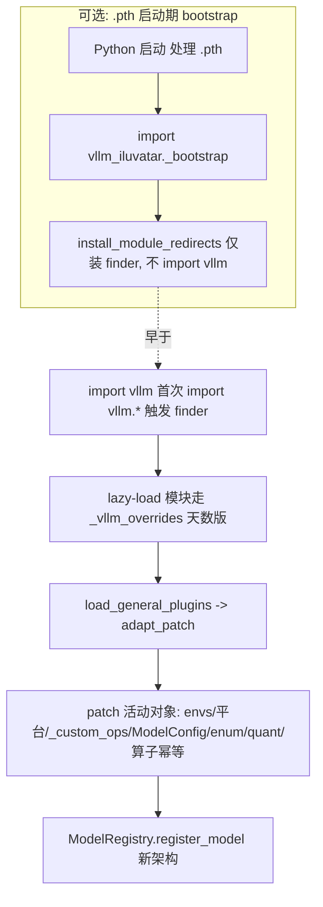

# vllm-iluvatar 架构说明

本文面向想要维护或扩展 `vllm-iluvatar` 的开发者，只讲大模块的职责与设计取舍。
只想把模型跑起来看 [README.md](../README.md)。

---

## 1. 总体设计

`vllm-iluvatar` 是基于 vLLM 官方
[插件系统](https://docs.vllm.ai/en/latest/design/plugin_system.html)的 Out-of-Tree
插件，**不修改社区 vLLM 源码**，而是在运行期把天数内部 fork 的改动"叠加"到社区版之上。

叠加用两种手段，按目标模块的加载时机选择：

- **整文件 overlay（`_vllm_overrides/`）**：用于**lazy load、import-once** 的模块
  （模型、attention 后端、量化、fused-moe、worker、通信栈等）。这些模块在插件加载后
  才首次 import，可以由一个 `MetaPathFinder` 拦截，直接提供天数版整文件。
- **就地 monkey-patch（`patch/`）**：用于**会被早 import、或被广泛 `from x import y`
  持有引用**的活动对象（环境变量、CUDA 平台单例、`vllm._custom_ops`、`ModelConfig`、
  `AttentionBackendEnum`、量化方法表等）。这些对象 overlay 改不动已经活着的实例 /
  已被持有的引用，只能就地改属性 / 包装方法。

> 总结：**结构性重写 + lazy load → overlay；活动对象 + 早加载 → patch。**

插件有两条加载路径：

1. **`vllm.general_plugins` entry_point**（见 [pyproject.toml](../pyproject.toml) →
   [`__init__.py`](../vllm_iluvatar/__init__.py)）：vLLM 启动时调
   `load_general_plugins()` 触发 `register_model()` → `adapt_patch()`。这是**主路径**，
   跑全部 patch + 模型注册。
2. **`.pth` 启动期 bootstrap**（可选但推荐）：在 `import vllm` **之前**就把 overlay
   finder 装好，保证早加载模块（尤其通信栈）首次 import 就拿到天数版。详见第 3 节。

---

## 2. 目录结构（大模块）

```text
vllm_iluvatar/
├── __init__.py          # entry_point: register_model()
├── utils.py             # adapt_patch() —— 加载顺序总编排
├── _bootstrap.py        # 解释器启动期装 finder（由 .pth 触发，不 import vllm）
├── patch/               # 就地 monkey-patch（针对活动对象）
├── _vllm_overrides/     # 镜像树：整文件 overlay 的 vllm.* 模块
├── models/              # 社区没有的新模型架构注册
├── _ilu_custom_ops.py   # 天数 _custom_ops 全量副本（被 splat 到 vllm._custom_ops）
└── ops.py               # _custom_ops 的轻量 4-op 回退（无 ixformer 时用）

scripts/
├── install_bootstrap.py # 写入 / 删除 .pth bootstrap
└── smoke_test.py        # 安装后注册级自检（CPU 可跑）
```

---

## 3. 加载时序



要点：

- **finder 只会被安装一次**：安装 finder 的 `install_module_redirects()` 会被两处调用——
  `.pth` bootstrap（启动期）和 `adapt_patch()`（entry_point 加载时）。它内部用一个
  `_INSTALLED` 标志守卫：第一次调用真正安装 finder，之后任何一次调用都直接返回、什么都不做。
  所以即使装了 bootstrap（已先安装），`adapt_patch` 里再调用一次也不会重复安装；没装
  bootstrap 时，则由 `adapt_patch` 这次调用来完成安装。
- **装了 bootstrap**：finder 早于 `import vllm` 生效，通信栈（`parallel_state` 等）首次
  import 就是天数 overlay，进程内单一模块对象，ixformer 通信生效。
- **没装 bootstrap**：只走 entry_point 主路径；此时通信栈已被社区版 import，finder 不驱逐
  它们（`_NO_EVICT`），回退社区 NCCL（功能可用，仅无 ixformer 通信优化）。

---

## 4. 各模块职责

### `_bootstrap.py` + `scripts/install_bootstrap.py`（`.pth`）

`install_bootstrap.py` 往 site-packages 写一个 `.pth`，其单行在解释器启动期
`import vllm_iluvatar._bootstrap`，后者只做一件事：把 overlay finder 装上
`sys.meta_path`（**不 import vllm**、吞异常）。目的是让早加载模块也能走 overlay，从而
保留 ixformer 通信优化。可用 `--uninstall` 移除回退到纯 entry_point 模式。

### `_vllm_overrides/`（整文件 overlay）

镜像 vLLM 包树：模块路径与文件路径一一对应（`vllm.a.b` ↔ `_vllm_overrides/vllm/a/b.py`）。
finder（`patch/patch_sys_modules.py`）走 `sys.meta_path` 自动发现并服务这些文件，无需手
维护映射表。承载"结构性重写或纯新增、且 lazy load"的模块：各模型、attention 后端、量化、
fused-moe、worker、KV cache、通信栈等。overlay 文件保留原 `vllm....` 限定名，内部
`from vllm.x import y` 照常走正常 import，不需要改写。

### `patch/`（就地 monkey-patch）

针对活动对象就地改属性 / 包装方法，按职责分文件（不逐一罗列实现细节）：

- 环境变量注入与默认值调整
- `torch.accelerator` 兼容 backfill（旧 corex torch）
- `vllm._custom_ops`：把天数实现 splat 上去（失败回退 4-op）
- `ModelConfig`：tokenizer_mode / cuda graph 等行为
- CUDA 平台单例：attention 后端路由、设备能力、算子开关
- `AttentionBackendEnum`：注入 ILU_* 成员
- 量化方法表：把 gptq/awq 等重映射到 ilu 实现
- 自定义算子注册幂等化（防止 overlay 重执行时重复注册 `vllm::*`）
- `patch_sys_modules.py`：overlay finder 本体（`patch/` 与 `_vllm_overrides/` 的桥梁）

### `utils.adapt_patch()` 与 `models/`

`adapt_patch()` 按固定顺序编排各步骤。关键约束：**算子注册幂等化、环境变量注入要排在装
finder 之前**——因为 finder 一旦装上就可能触发模块重导入（进而注册算子 / 读环境变量），必须
先把这两件事准备好。其余属性级 patch（`_custom_ops` / 平台 / enum / 量化）改的是已存在的社区
对象，相对 finder 的先后不敏感。`models/` 负责注册社区没有的新架构（如
`IluDeepseekV4ForCausalLM`）；社区已注册的架构由 finder 重定向其模型模块自动接管，无需重复注册。

---

## 5. 升级维护指南

当社区 vLLM 基线（base）升级到新版本时，插件可能跟不上，需要按下面三步检查。
背景：插件用两种方式叠加改动——`_vllm_overrides/` 是**整份文件拷贝**（whole-file
overlay），`patch/` 是**就地改某个函数 / 方法**（monkey-patch）。两者都"钉"在某个具体的
社区版本上，所以社区一升级就可能失配。

1. **更新 `_vllm_overrides/` 里的整份拷贝**：overlay 文件是从某个旧社区版本完整拷贝过来、
   再加上天数改动的。社区升级后，如果社区那边也改了同一个文件，我们这份拷贝还停留在旧内容，
   就会缺掉社区的新改动。处理办法：拿社区新版本的该文件，把天数的改动重新合并上去，替换掉旧拷贝。
2. **检查 `patch/` 打补丁的目标有没有变**：patch 是去改社区某个具体函数 / 方法 / 字段，依赖
   它的名字、参数、返回值保持不变。社区升级后如果把这些改了（改名、加减参数、换返回类型等），
   对应的 patch 就会报错或失效，需要照着新版本同步改。
3. **跑 `scripts/smoke_test.py` 自检**：它做的是"注册级"检查（entry_point 能被发现、finder
   已安装、模型 / 量化 / attention 后端都已就绪等）。全部打印 `[OK]` 才算升级成功；哪一项是
   `[FAIL]`，就去对应的模块排查。
