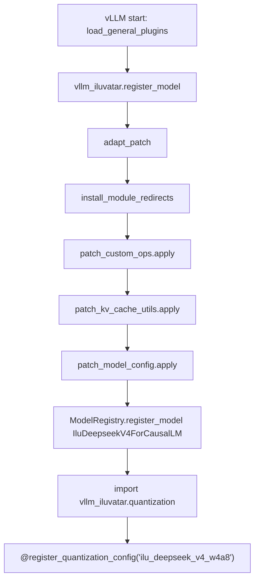

# vllm-iluvatar 架构说明

本文面向想要维护或扩展 `vllm-iluvatar` 的开发者。如果只是要把模型跑起来，
请先看仓库根的 [README.md](../README.md)。

---

## 1. 总体设计

`vllm-iluvatar` 是基于 vLLM 官方 [插件系统](https://docs.vllm.ai/en/latest/design/plugin_system.html)
的 Out-of-Tree 硬件插件，通过 `vllm.general_plugins` entry_point 在 vLLM 启动
时自动加载，**不修改 vLLM 主仓源码** 即可桥接 DeepSeek-V4 W4A8 路径。

vLLM 启动时会调用 `vllm.plugins.load_general_plugins()`，进而扫描 entry_point
组 `vllm.general_plugins`。本插件在 [pyproject.toml](../pyproject.toml) 中登记：

```toml
[project.entry-points."vllm.general_plugins"]
vllm_iluvatar = "vllm_iluvatar:register_model"
```

`register_model()` 见 [vllm_iluvatar/__init__.py](../vllm_iluvatar/__init__.py)，
按固定顺序执行 3 步：

1. **`adapt_patch()`** —— 安装所有 `sys.modules` 重定向 + 属性级 monkey-patch。
2. **`ModelRegistry.register_model("IluDeepseekV4ForCausalLM", ...)`** —— 注册
   新模型架构，让 vLLM 能根据 `config.json` 里的 `architectures` 字段解析到
   本仓的实现。
3. **`import vllm_iluvatar.quantization`** —— 触发
   `@register_quantization_config("ilu_deepseek_v4_w4a8")` 装饰器执行，把新的
   量化方法注入 `QUANTIZATION_METHODS`。

---

## 2. 目录结构

```text
vllm-iluvatar/
├── pyproject.toml                    # entry_points: vllm.general_plugins
├── setup.py                          # 兼容旧工具链的 shim
├── requirements.txt                  # 运行时依赖由外部 vLLM/Iluvatar 安装提供
├── README.md                         # 用户视角文档
├── docs/
│   └── ARCHITECTURE.md               # 本文（开发者视角）
├── scripts/
│   └── smoke_test.py                 # 安装后自检脚本（6 项断言）
└── vllm_iluvatar/
    ├── __init__.py                   # register_model() entry point
    ├── utils.py                      # adapt_patch() 总编排
    ├── envs.py                       # 预留的插件级环境变量（当前为空）
    ├── ops.py                        # 4 个 ilu 实现的 ops（被 patch_custom_ops 注入）
    ├── models/
    │   ├── __init__.py               # ModelRegistry.register_model(...)
    │   └── ilu_deepseek_v4.py        # IluDeepseekV4ForCausalLM
    ├── layers/
    │   ├── __init__.py
    │   ├── activation.py             # SiluAndMulWithClamp 本地子类
    │   └── ilu_deepseek_v4_attention.py
    ├── quantization/
    │   ├── __init__.py               # import 即触发 @register_quantization_config
    │   └── ilu_deepseek_v4_w4a8.py
    ├── attention/
    │   ├── __init__.py
    │   └── ilu_sparse_swa.py         # IluDeepseekV4SWACache 等
    ├── patch/                        # 小粒度 monkey-patch（4 个 apply()）
    │   ├── __init__.py
    │   ├── patch_sys_modules.py      # MetaPathFinder + _replacements/ 加载器
    │   ├── patch_custom_ops.py       # 在 vllm._custom_ops 上注入 ilu ops
    │   ├── patch_model_config.py     # 包装 ModelConfig.__post_init__
    │   └── patch_kv_cache_utils.py   # 替换 _get_kv_cache_config_deepseek_v4 等
    └── _replacements/                # 整文件替换：6 个 vLLM 模块的 dsv4 版本
        ├── __init__.py               # 空文件，仅作 package 标记
        ├── sparse_swa.py
        ├── ilu_flashmla_sparse.py
        ├── ilu_indexer.py
        ├── moe_runner.py
        ├── moe_runner_interface.py
        └── ilu_compressed_tensors_moe_w4a8_int8.py
```

---

## 3. 初始化流程

整个 plugin 的加载顺序由 [vllm_iluvatar/utils.py](../vllm_iluvatar/utils.py)
里的 `adapt_patch()` 严格编排：



**顺序约束**：

- `install_module_redirects()` **必须最先执行**：它注册一个 `MetaPathFinder`，
  下游模块的 `import` 才会被拦到我们 `_replacements/` 下的副本。属性级 patch
  打的是「正在使用」的模块，应该在 finder 装好之后再做，避免把属性设到
  「即将被替换掉」的旧模块对象上。
- 三个属性级 patch 的相对顺序不敏感，但都是幂等的（用 `_ilu_patched` 标志
  守卫，详见各文件源码）。

---

## 4. `patch/` 与 `_replacements/` 的分工

两者**都是为了把 stock vLLM 改造成跑 DeepSeek-V4 W4A8**，但粒度、机制、风险完全不同。

| 维度 | `patch/` | `_replacements/` |
| --- | --- | --- |
| **机制** | `setattr` / 方法包装 / `register_fake` | `MetaPathFinder` + `spec_from_file_location` |
| **粒度** | 函数级、属性级 | 模块级（整 `.py`） |
| **执行时机** | `adapt_patch()` 调用时**立即生效** | finder 装好后，**下次 `import` 时**才生效（支持懒导入） |
| **幂等性** | 显式 `_ilu_patched` 标志 | `_INSTALLED` 标志 + 已 import 的模块从 `sys.modules` 中踢出 |
| **代码量** | 约 460 行（4 个文件） | 约 3800 行（6 个文件） |
| **升级 vLLM 的影响** | 小（只要被改函数签名稳定即可） | 大（上游对应文件变动需人工合并 dsv4 delta） |
| **被 patch 对象是否已加载** | 通常已加载（直接改属性） | **可以未加载**（finder 拦截首次 import） |

### 为什么是这种二分法

`patch/` 适合「改一两个函数 / 属性」：改动量小、目标精确，对 vLLM 升级最友好。

`_replacements/` 适合「整个模块结构都变了」：上游 `support_dsv4` 分支这 6 个
模块的改动**不止改一两个属性**，往往新增类、新增字段、改 Triton kernel 调用。
用 `setattr` 一行行注几十处改动既丑又脆，整文件替换更稳。

> 小细节：`patch_sys_modules.py` 物理上放在 `patch/` 里，但它的角色其实是
> 「`_replacements/` 的加载器」，可以理解为这两个目录的桥梁。

---

## 5. Patch 清单（完整 reference）

### 5.1 `patch/` 的 4 个属性级 patch

| 文件 | 目标模块 | 改什么 | 怎么改 |
| --- | --- | --- | --- |
| [`patch_custom_ops.py`](../vllm_iluvatar/patch/patch_custom_ops.py) | `vllm._custom_ops` | 新增 `silu_and_mul_with_clamp` / `router_gemm_bf16_fp32`（Iluvatar 上无对应原生 kernel）；替换 `topk_hash_softplus_sqrt`（Iluvatar 无对应 kernel，改纯 PyTorch 实现）；修正 `dsa_convert_req_index_to_global_index` 的 dispatch 路径 | `setattr` 把 [`vllm_iluvatar/ops.py`](../vllm_iluvatar/ops.py) 的实现挂到模块属性上 |
| [`patch_model_config.py`](../vllm_iluvatar/patch/patch_model_config.py) | `vllm.config.model.ModelConfig` | 让 `architectures` 含 `IluDeepseekV4ForCausalLM` 时自动默认 `tokenizer_mode = "deepseek_v4"`（镜像上游 `DeepseekV4ForCausalLM` 分支的行为） | 包装 `__post_init__`：调用原方法后追加 Ilu 架构的判断 |
| [`patch_kv_cache_utils.py`](../vllm_iluvatar/patch/patch_kv_cache_utils.py) | `vllm.v1.core.kv_cache_utils` | `_get_kv_cache_config_deepseek_v4` 由 2-tuple 改为 3-tuple（增加 `kv_cache_scale_tensors`），其唯一调用方 `get_kv_cache_config_from_groups` 同步解包 | `setattr` 把替换函数挂上去 |
| [`patch_sys_modules.py`](../vllm_iluvatar/patch/patch_sys_modules.py) | Python 导入系统 | 注册 `_IluRedirectFinder` 到 `sys.meta_path[0]`，并把已 import 的 6 个目标模块从 `sys.modules` 中踢出 | 见下一节 |

### 5.2 `_replacements/` 的 6 处整文件替换

`_REDIRECTS` 字典定义在
[`patch_sys_modules.py`](../vllm_iluvatar/patch/patch_sys_modules.py)，
将下表「上游 vLLM 模块路径」拦截到「本仓副本」：

| 上游 vLLM 模块路径 | 本仓副本文件 | 改动要点 |
| --- | --- | --- |
| `vllm.v1.attention.backends.mla.sparse_swa` | [`sparse_swa.py`](../vllm_iluvatar/_replacements/sparse_swa.py) | `DeepseekSparseSWAMetadataBuilder` 把 Triton kernel（Iluvatar 上跑不通）换成 `ixformer.inference.functions.ds4_*` 纯 tensor 等价实现，并加 `_is_flashmla_available()` 早退 |
| `vllm.v1.attention.backends.mla.ilu_flashmla_sparse` | [`ilu_flashmla_sparse.py`](../vllm_iluvatar/_replacements/ilu_flashmla_sparse.py) | 新增 DeepSeek-V4 字段（`compress_ratio`、C128A topk metadata）和 `IluDeepseekV4FlashMLASparseBackend` 子类 |
| `vllm.v1.attention.backends.mla.ilu_indexer` | [`ilu_indexer.py`](../vllm_iluvatar/_replacements/ilu_indexer.py) | `kv_spans_from_batches` 支持 `compress_ratio` |
| `vllm.model_executor.layers.fused_moe.iluvatar_runner.moe_runner` | [`moe_runner.py`](../vllm_iluvatar/_replacements/moe_runner.py) | 新增 `input_ids` 参数用于 V4 hash routing |
| `vllm.model_executor.layers.fused_moe.iluvatar_runner.moe_runner_interface` | [`moe_runner_interface.py`](../vllm_iluvatar/_replacements/moe_runner_interface.py) | 接口同步加 `input_ids` 参数 |
| `vllm.model_executor.layers.quantization.compressed_tensors.compressed_tensors_moe.iluvatar.ilu_compressed_tensors_moe_w4a8_int8` | [`ilu_compressed_tensors_moe_w4a8_int8.py`](../vllm_iluvatar/_replacements/ilu_compressed_tensors_moe_w4a8_int8.py) | 新增 `swiglu_limit_dynamic_scaled_int8` 融合路径用于 V4 MoE |

### 5.3 一个特殊点：`SiluAndMulWithClamp`

`vllm.model_executor.layers.activation.SiluAndMulWithClamp` 本身**没有**被
patch。它原本会派发到 `torch.ops._C.silu_and_mul_with_clamp`（CUDA-only，
Iluvatar 上没编译），我们绕过它的方式是：在 [`layers/activation.py`](../vllm_iluvatar/layers/activation.py)
里写一个**本地子类**，直接调用 `vllm._custom_ops.silu_and_mul_with_clamp`
（这个属性由 `patch_custom_ops.py` 注入），DeepSeek-V4 模型代码引用本地子类
而不是上游 class。

---

## 6. 升级维护指南

当 vLLM `iluvatar_main` 分支前进时，按以下顺序检查：

### 6.1 检查 `_replacements/` 的 6 个文件（高风险）

```bash
# 对每一个 _replacements/ 文件，与上游 iluvatar_main 分支的对应路径做 diff
for f in sparse_swa ilu_flashmla_sparse ilu_indexer moe_runner moe_runner_interface; do
  diff -u "{{VLLM_REPO}}/vllm/v1/attention/backends/mla/${f}.py" \
          "vllm_iluvatar/_replacements/${f}.py"
done
# ilu_compressed_tensors_moe_w4a8_int8 路径较长，按 _REDIRECTS 字典查
```

- 上游**没动** ⇒ 保持原样。
- 上游**有动**且与 dsv4 delta **不冲突** ⇒ 把上游 diff cherry-pick 到本仓副本。
- 上游**有动**且**冲突** ⇒ 人工三向合并，重点确保 dsv4 新增的类/字段
  （`IluDeepseekV4FlashMLASparseBackend` / `compress_ratio` / `input_ids` /
  `swiglu_limit_dynamic_scaled_int8`）不会被冲掉。

### 6.2 检查 `patch/` 的 4 个 `apply()`（低风险）

属性级 patch 对函数签名敏感。若上游改了下面这些函数的签名或调用方式，需要
对应更新：

- `ModelConfig.__post_init__` 的签名
- `vllm.v1.core.kv_cache_utils._get_kv_cache_config_deepseek_v4` 的入参 / 返回 tuple 长度
- `vllm._custom_ops` 上四个属性的预期调用约定
- `vllm.config.model.ModelConfig._architecture` 字段名是否仍存在

### 6.3 跑一次 `smoke_test.py`

```bash
python scripts/smoke_test.py
```

6 个 `[OK  ]` 全过 ⇒ 升级完成。否则按 `[FAIL]` 列出的项定位到具体 patch
模块去查。
