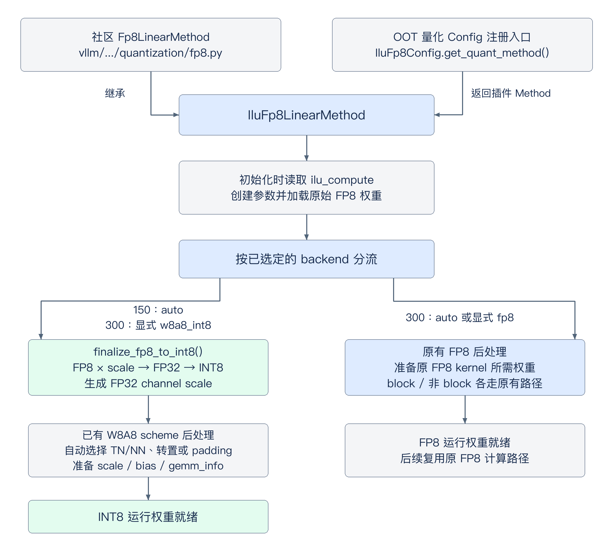
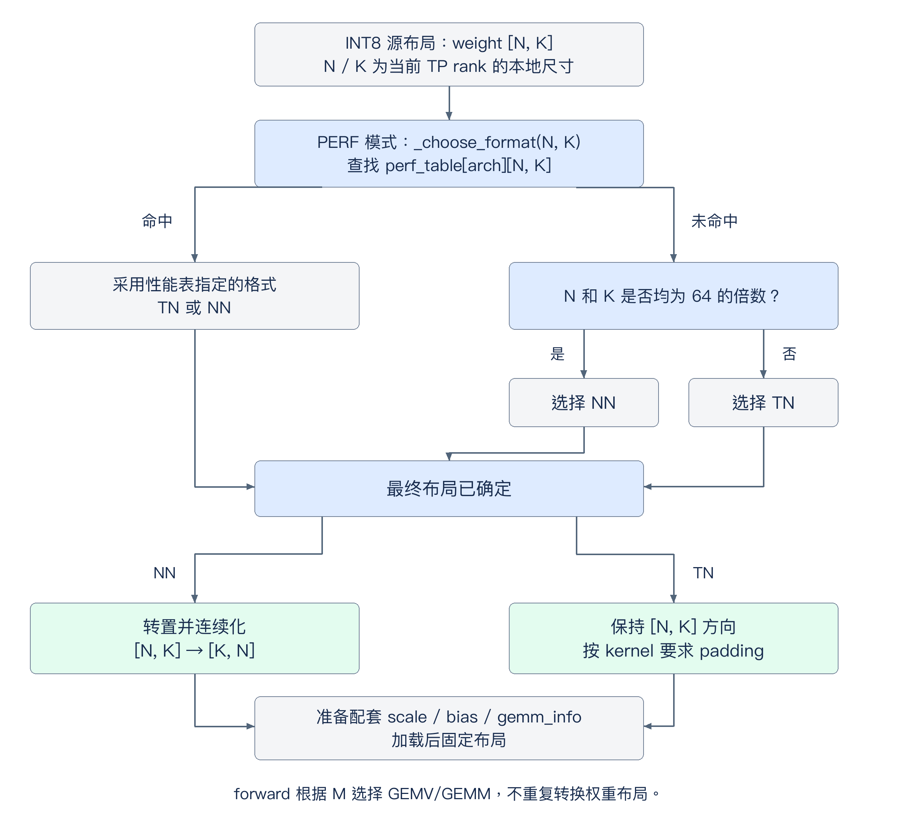

# 原始 FP8 Linear 的计算选择与权重布局

> **开发者设计文档** · OOT 量化接入 · 原始权重加载与执行格式分离

---

## 目录

- [1. OOT 接入与加载后处理](#1-oot-接入与加载后处理)
- [2. 在 300 上指定 INT8 计算](#2-在-300-上指定-int8-计算)
- [3. INT8 Linear 的自动布局选择](#3-int8-linear-的自动布局选择)
- [4. 文件职责](#4-文件职责)

---

## 1. OOT 接入与加载后处理

`IluFp8LinearMethod` 继承社区 `vllm.model_executor.layers.quantization.fp8.Fp8LinearMethod`。插件通过 `@register_quantization_config("fp8")` 注册 `IluFp8Config`，由其 `get_quant_method()` 为原始 FP8 Linear 返回插件 Method；模型专用 Config 也可以返回该 Method 的子类。接入使用量化 Config 注册机制，不是 `CustomOp.register_oot` 装饰器。

计算方式在初始化时确定：150（`ivcore11`）默认使用 W8A8 INT8，300（`ivcore30`）默认保留 FP8，也支持显式选择 W8A8 INT8。两条路径均按源 checkpoint 创建参数、绑定 TP/fused loader 并加载权重；运行格式在 `process_weights_after_loading()` 中准备完成。当前 Config 位于 `quantization/configs/fp8.py`，Method 位于 `quantization/backends/fp8/linear.py`，二者不再放在同一文件。

图 1：OOT 接入、150/300 后处理，以及 300 显式选择 INT8



[可编辑 SVG 源图](images/fp8-linear-oot-and-post-loading.svg)

INT8 后处理分为两步：`finalize_fp8_to_int8()` 在 FP32 中计算反量化值与逐输出通道 scale，生成 INT8 权重；随后已有 `IluCompressedTensorsW8A8Int8` 准备布局、padding、scale 和 bias。转换不引入 BF16 中间舍入。FP8 分支沿用已有后处理，其中 block-FP8 可以由已选择的 kernel 完成 block-to-channel FP8 重量化。

权重转换及布局准备发生在加载阶段，forward 和 CUDA Graph replay 只消费准备好的运行权重。本文只描述普通 FP8 Linear；MoE group-gemm 和 attention 消费的 grouped BMM 使用各自的接入契约。

### 1.1 源参数与转换的分工

INT8 分支通过 `common/fp8_weights.py` 的 `create_fp8_source_weights()` 创建源 `weight` 和 scale，保留传入的社区 `weight_loader`。block 源使用 `weight_scale_inv`，非 block 源使用 `weight_scale`；scale dtype 由源配置决定，不能为了目标是 INT8 提前改写源参数或绕过 TP/fused 装配。

`finalize_fp8_to_int8()` 管理参数发布与旧 scale 清理，数值转换在 `conversions/fp8_to_int8.py` 中。block 转换按源行块执行：源 FP8 和 FP32/E8M0 scale 转成 FP32，反量化后按本地输出通道求 `amax/127`，round、clamp 到 `[-127,127]`，输出 INT8 权重与 FP32 channel scale。全零通道使用 scale=1。转换器处理不足完整 block 的尾部，避免整层 FP32 临时副本；这不取消创建参数时社区对 TP/block 形状的校验。

显式 `ilu_runtime/linear/fp8_to_w8a8.py` 工厂复用同一个纯转换器，校验来源、转换阶段和 128×128/32×32 block 是否匹配 checkpoint。纯转换模块不导入 Config、runtime registry 或模型，默认 150 路径也不经由仅向 ivcore30 开放的 `ilu_quant` 入口。

### 1.2 普通 Linear 与 grouped BMM 的边界

DeepSeek V4.1 普通 dense Linear 使用 `backends/fp8/deepseek_v41_linear.py` 中的适配子类，复用上述计算选择。选 FP8 时，本地 K 小于 64 或不能被 64 整除沿用已有 BF16 fallback；选 INT8 时由 W8A8 scheme 自己处理布局，不套用 FP8 的 K 限制。

`wo_a` 在 TP<8 时由 attention 按 grouped BMM 消费，不能按普通 Linear 处理。150 且启用既有 grouped INT8 开关时，`backends/grouped_bmm/deepseek_v4_wo_a.py` 的 `IluDeepseekV41Fp8GroupedInt8Method` 适配 FP8 源参数与转换，继承 `IluV4W8A8BMMLinearMethod` 的分组布局和执行；其他既有情况保留 BF16 消费。TP≥8 的普通 Linear 分支、ignored BF16 层及 Engram 自有消费者分别保留。`linear.fp8_backend` 不覆盖这些独立的消费契约。

---

## 2. 在 300 上指定 INT8 计算

执行偏好放在 `additional_config.ilu_compute`，不修改 checkpoint 的 `quantization_config`。启动参数如下；已有 `additional-config` 时，将 `ilu_compute` 合并到同一个 JSON 对象。

```bash
--additional-config '{"ilu_compute":{"schema_version":1,"linear":{"fp8_backend":"w8a8_int8"}}}'
```

`linear.fp8_backend` 的取值：

- `auto`（默认）：150 使用 `w8a8_int8`，300 使用 `fp8`。
- `w8a8_int8`：150、300 均可显式选择。
- `fp8`：显式选择仅支持 300，150 会报不支持。

适用边界：

- 此选项不自动将 BF16 源转换为 INT8；需要额外转换时使用显式 `ilu_quant`。已有 online quant 入口继续保留，显式 FP8 计算与 FP8→INT8 online quant 冲突时拒绝。
- FP8→INT8 当前要求动态激活量化，拒绝已预处理的 runtime 权重作为源。旧 compressed-tensors checkpoint 继续使用已有入口。
- Row-parallel 的 channel scale 按当前 rank 的本地 K 分片计算，不保证与离线 full-K 量化结果逐字节相同。
- 300 的默认 FP8 路径不经过 INT8 布局选择器；显式选择 INT8 才进入下节流程。

---

## 3. INT8 Linear 的自动布局选择

FP8→INT8 转换先生成 `[N, K]` 权重和 FP32 channel scale，其中 N、K 是当前 TP rank 的本地尺寸。`IluFp8LinearMethod` 创建 W8A8 scheme 时使用 `gemm_mode="PERF"`，后处理的 `_choose_format(N, K)` 优先查找 `perf_table[arch][N, K]`；未命中时，N 和 K 均为 64 的倍数则选择 NN，否则选择 TN。

图 2：INT8 Linear 如何自动选择 TN/NN



[可编辑 SVG 源图](images/int8-linear-weight-layout-selection.svg)

- **NN**：将权重由 `[N, K]` 转置为连续的 `[K, N]`。
- **TN**：保持 `[N, K]` 方向，按 kernel 要求进行 padding；scale、bias 与最终输出通道对齐。
- **初始化值不等于强制布局**：传入的 `gemm_format="TN"` 会被 `_choose_format()` 的结果覆盖，不能据此认定所有层最终都为 TN。
- **布局与执行调度分离**：布局在加载后固定；forward 再根据实际 M 选择已有 GEMV/GEMM。M 是展平后的输入行数，不是权重布局选择条件。

---

## 4. 文件职责

### 4.1 计算选择与权重转换

以下路径相对仓库根目录。量化目录承接主分支的职责划分，移除了 `ivcore30/` 目录层级；硬件检查仍由 `capabilities.py`、compute 选择器、runtime 工厂及具体 backend 执行，目录上提不表示所有实现支持所有设备。

- [`config/ilu_compute.py`](../../vllm_iluvatar/config/ilu_compute.py)：解析与校验 `ilu_compute`，`fp8_linear_backend()` 确定架构默认值和显式覆盖。
- [`quantization/configs/fp8.py`](../../vllm_iluvatar/model_executor/layers/quantization/configs/fp8.py)：`IluFp8Config` 保留 checkpoint 与 ignored 层原分发，再接入显式 `ilu_quant`。
- [`quantization/backends/fp8/linear.py`](../../vllm_iluvatar/model_executor/layers/quantization/backends/fp8/linear.py)：`IluFp8LinearMethod` 串联计算选择、源参数创建、后处理和 apply；复用 FP8 或既有 W8A8 执行。
- [`quantization/common/fp8_weights.py`](../../vllm_iluvatar/model_executor/layers/quantization/common/fp8_weights.py)：创建源参数并保留 loader；加载后转换、发布运行参数并清理旧 scale。
- [`quantization/conversions/fp8_to_int8.py`](../../vllm_iluvatar/model_executor/layers/quantization/conversions/fp8_to_int8.py)：纯 FP32 反量化与逐通道 INT8 转换，供默认 Method 和显式 runtime Method 共用。
- [`quantization/ilu_runtime/linear/fp8_to_w8a8.py`](../../vllm_iluvatar/model_executor/layers/quantization/ilu_runtime/linear/fp8_to_w8a8.py)：显式 online quant 的 Method/factory，校验来源、阶段、block 和 compute 冲突；不承担普通 FP8 Method 的默认分发。

### 4.2 复用的注册与执行组件

- [`ilu_register/__init__.py`](../../vllm_iluvatar/ilu_register/__init__.py) 与 [`quantization/_registration.py`](../../vllm_iluvatar/model_executor/layers/quantization/_registration.py)：前者触发量化包发现，后者显式导入嵌套模块；先导入 backend/runtime method，再导入 checkpoint Config，避免依赖目录扫描顺序。公开 Config 和 method 注册名保持原约定。
- [`IluCompressedTensorsW8A8Int8`](../../vllm_iluvatar/model_executor/layers/quantization/compressed_tensors/schemes/ilu_compressed_tensors_w8a8_int8.py)：已有性能表、TN/NN、padding、激活量化及 GEMV/GEMM 调度的归属。
- [`IluFp8BlockScaledMMKernel`](../../vllm_iluvatar/model_executor/kernels/linear/scaled_mm/ilu_fp8_block_scaled_mm.py)：300 的 block-FP8 权重后处理与执行。
- [`backends/fp8/deepseek_v41_linear.py`](../../vllm_iluvatar/model_executor/layers/quantization/backends/fp8/deepseek_v41_linear.py) 与 [`backends/grouped_bmm/deepseek_v4_wo_a.py`](../../vllm_iluvatar/model_executor/layers/quantization/backends/grouped_bmm/deepseek_v4_wo_a.py)：普通 dense 与 grouped BMM 消费者分别接线，不互相覆盖计算偏好。

### 4.3 测试与相关文档

- [`test_ilu_compute_config.py`](../../tests/model_executor/layers/quantization/test_ilu_compute_config.py)：验证架构默认值、显式选择与非法配置拒绝。
- [`test_ilu_fp8_to_w8a8_linear.py`](../../tests/model_executor/layers/quantization/test_ilu_fp8_to_w8a8_linear.py)：验证转换器和 online quant 契约；32×32 测试覆盖 E8M0/FP32 scale、尾部行块及 FP32 数值参考，检查没有引入 BF16 中间舍入。
- [`test_ilu_deepseek_v41_compute.py`](../../tests/model_executor/layers/quantization/test_ilu_deepseek_v41_compute.py)：验证普通 Linear 与 grouped 消费者分发、分组权重和 scale 顺序。
- [`test_fp8.py`](../../tests/model_executor/layers/quantization/test_fp8.py)：覆盖保留的 FP8 路径；测试对象显式设置 `int8_scheme=None`。
- [运行时量化指南](../guides/8-how-to-use-iluvatar-runtime-quant-via-additional-config.md)：说明 `ilu_quant`、`ilu_compute` 的使用方式与兼容边界。

在已配置 vLLM、插件和 IxFormer 的开发环境中，可运行相关测试：

```bash
python -m pytest -q \
  tests/model_executor/layers/quantization/test_ilu_compute_config.py \
  tests/model_executor/layers/quantization/test_ilu_fp8_to_w8a8_linear.py \
  tests/model_executor/layers/quantization/test_ilu_deepseek_v41_compute.py \
  tests/model_executor/layers/quantization/test_fp8.py
```

PNG 用于文档直接展示，SVG 保留同名可编辑源图。修改调用链或布局规则时，应同步更新两种格式；按受影响契约选择测试。配置/mock 检查不代替设备数值、模型精度或性能验证，具体运行记录归验证报告。
