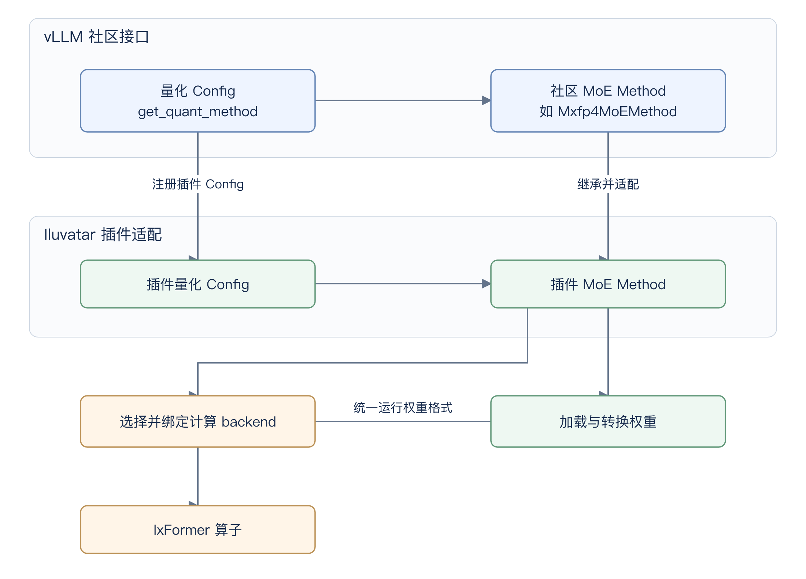
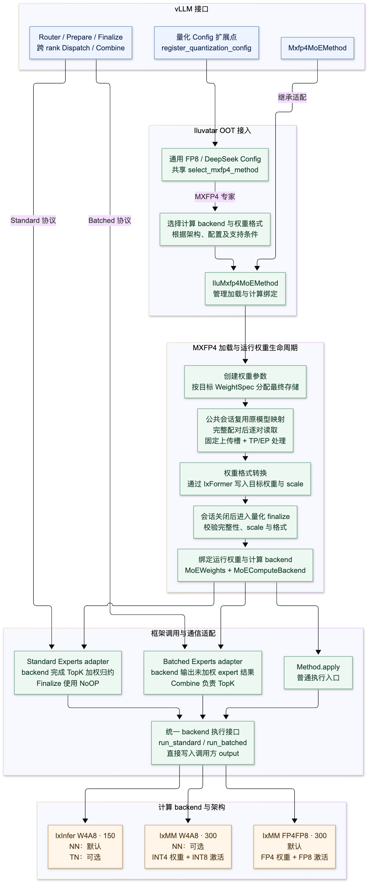
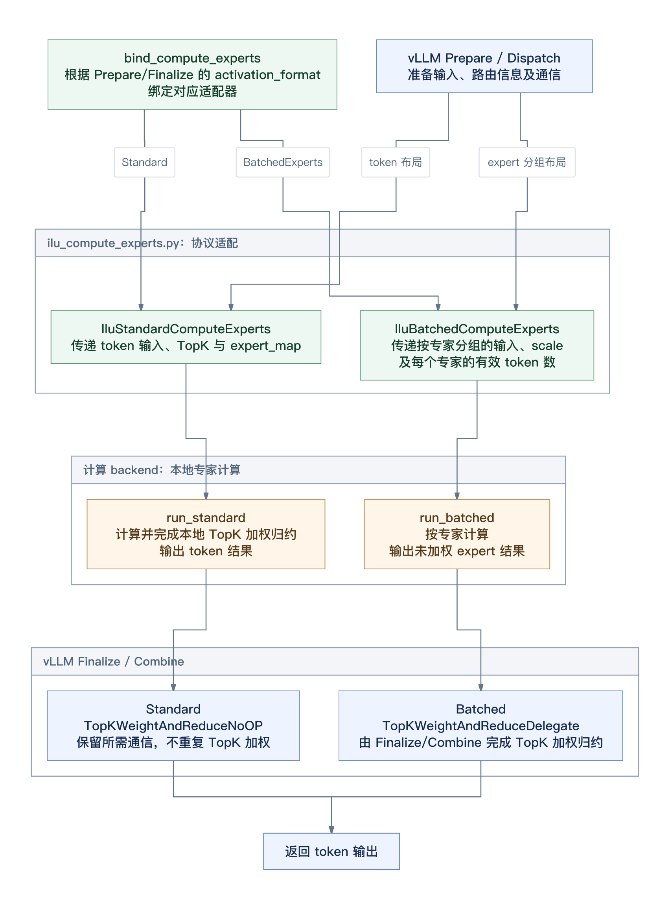
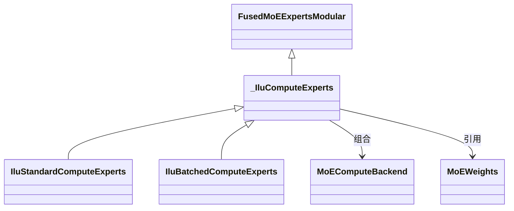
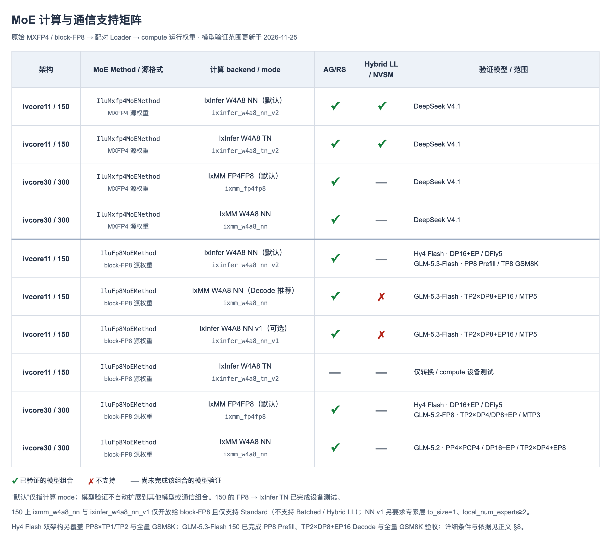

# MoE 的框架接入、权重加载与计算 backend

> **开发者设计文档** · OOT 量化接入 · 源权重、运行格式与通信适配分离

---

## 目录

- [1. 框架接入与改造思路](#1-框架接入与改造思路)
- [2. 以 MXFP4 为例的适配流程](#2-以-mxfp4-为例的适配流程)
- [3. Method 与 Loader 的职责](#3-method-与-loader-的职责)
- [4. 计算 backend 的公共设计与实现](#4-计算-backend-的公共设计与实现)
- [5. Standard 与 Batched 通信适配](#5-standard-与-batched-通信适配)
- [6. 配置与扩展方法](#6-配置与扩展方法)
- [7. 文件职责与验证入口](#7-文件职责与验证入口)
- [8. 支持矩阵](#8-支持矩阵)

---

## 1. 框架接入与改造思路

vLLM 通过量化 Config 的 `get_quant_method()` 为专家层选择 MoE Method。插件使用 `register_quantization_config` 注册自己的 Config，再返回继承并适配社区接口的 Method。量化接入采用 Config 注册机制，不使用 `CustomOp.register_oot`。

本次设计将 MoE 拆成三个可独立扩展的部分：

- **源格式适配**：Method 对接 vLLM 生命周期，Loader 解释 checkpoint 并生成运行权重。
- **本地专家计算**：计算 backend 消费确定的权重格式，组织量化、两次投影、激活和本地归约。
- **通信协议适配**：Experts adapter 对接 Prepare/Finalize，向 backend 提供相应布局的输入。

模型接入层继续提供路由、激活参数和并行配置。可复用计算 backend 不依赖某个模型的 Config，也不解析 checkpoint。新增源格式时，可以复用已有 backend；新增 backend 时，需要提供与其目标格式匹配的权重转换。

图 1：MoE 框架接入与改造思路



[可编辑 SVG 源图](images/moe-framework-adaptation.svg) · [Mermaid 源码](images/moe-framework-adaptation.mmd)

本文以 vLLM 0.31 接口及 `IluMxfp4MoEMethod` 的统一 backend 路径说明设计。`IluFp8MoEMethod` 已按相同职责划分接入，block-FP8 的源转换见 §3.7；各模型实际验证的计算与通信组合见文末支持矩阵。

---

## 2. 以 MXFP4 为例的适配流程

`IluMxfp4MoEMethod` 继承社区 `Mxfp4MoEMethod`，保留 vLLM 的调用接口，替换其中的平台计算选择与加载处理。构造时调用 `FusedMoEMethodBase` 初始化，避免社区 Method 构造函数先选择不适用的计算实现。

当前入口包括通用 `configs/fp8.py` 的 `IluFp8Config` 与 `configs/deepseek/v4_fp8.py` 的 `IluDeepseekV4FP8Config`；V4.1 Config 继承后者的专家分支。两者最终都调用 `backends/fp4/mxfp4_moe.py` 的 `select_mxfp4_method()`，不各自维护 backend 选择逻辑。通用 FP8 Config 识别 `store_dtype` / `expert_dtype="mxfp4"`，两字段冲突时报错。顶层 Config 的 FP8 名称描述混合 checkpoint 的配置体系，本节的专家源权重仍是 MXFP4。

Config 先保留原有分发并解析显式 `ilu_quant`；已匹配 runtime MoE 转换时优先使用该 Method，与非 auto 的 `ilu_compute.moe` 同时指定则拒绝冲突。无显式 MoE compute 配置时，300 上旧 `torch` / `ixformer_native` 选择继续走原 MXFP4 实现，不启用本文的统一 Loader；旧 compressed-tensors 预转换 checkpoint 也保留独立 Config/Method，不冒充原始 MXFP4。

图 2：以 MXFP4 为例的 MoE 适配流程



[可编辑 SVG 源图](images/moe-mxfp4-adaptation.svg) · [Mermaid 源码](images/moe-mxfp4-adaptation.mmd)

加载阶段先确定计算 backend 和 `MoEWeightSpec`，随后按目标格式分配最终参数。checkpoint 读取器先扫描元数据，通过现有模型加载逻辑将延迟来源路由到参数回调；公共会话检查 weight/scale 配对后，再连续读取每一对源分片。量化 Loader 完成切片和转换，直接写入最终参数。加载完成后，Method 校验运行权重并绑定计算实例。

forward 只消费准备好的运行权重。改变常驻权重格式的 backend 选择发生在加载前；兼容同一存储契约的 GEMV/GEMM 调度可以保留在执行阶段。

图中的 Standard/Batched 分支表示适配接口。当前模型使用哪一条通信调用链，见第 5 节，不能由图中的接口存在性推断所有通信组合均已接通。

---

## 3. Method 与 Loader 的职责

### 3.1 Method 组织生命周期

`quantization/backends/fp4/mxfp4_moe.py` 包含公共 mode 选择策略和 `IluMxfp4MoEMethod`：

1. **选择目标**：`select_mxfp4_compute()` 将架构和公共 mode 映射为 backend 名称与布局。
2. **创建参数**：`create_weights()` 检查层配置，取得目标 `WeightSpec`，构造 Loader 并委托其注册参数与加载回调。
3. **完成绑定**：`process_weights_after_loading()` 调用 Loader 的 `finalize()`，再通过 backend 校验权重，保存运行权重和计算实例。
4. **连接执行**：`apply()` 调用 `run_standard()`；`select_gemm_impl()` 根据 Prepare/Finalize 创建对应 Experts adapter。

runner 的输出缩放信息可能在创建参数后才写入层，因此最终计算配置在加载完成时绑定。Method 不应把模型构造早期的临时配置误当成最终运行状态。

### 3.2 Loader、会话与读取器的分工

`quantization/common/mxfp4_loader.py` 中每层一个 `Mxfp4WeightLoader`：

- 按目标 `MoEWeightSpec` 分配最终 `w13_weight`、`w2_weight` 和 scale，不先分配整层 MXFP4 源参数。
- 注册带 `paired_weight_loader` 标记的社区签名 `weight_loader` 回调。
- 用层已有的 expert 映射把全局 expert ID 映射为本地 ID；非本 rank 返回未加载。
- 校验 projection、源 shape/dtype，w1/w3 沿 N 分片，w2 沿 K 分片；TP 切片发生在转换前。
- 把本地源切片搬到公共上传槽，调用 IxFormer converter 直接写最终参数；同步后才把该 `(expert, w1/w2/w3)` 记为已提交。
- `finalize()` 检查所有预期分片已提交、无 pending 和 scale 有限值，返回引用最终参数的 `MoEWeights`。

`model_loader/ilu_default_loader.py` 的 `PairedLoadSession` 负责跨层收集配对、完整性检查、调度读取与上传槽生命周期；`ilu_paired_weights.py` 负责来源描述、延迟视图与有界文件句柄缓存。Layer Loader 不根据文件排列猜配对，读取器也不重新实现模型的权重名称映射。

图 3：Method、公共加载会话与 Layer Loader 的职责


[可编辑 SVG 源图](images/moe-method-loader.svg) · [Mermaid 源码](images/moe-method-loader.mmd)

### 3.3 阶段一：运行现有模型映射，建立完整配对计划

`IluDefaultModelLoader` 遍历最终参数，从回调发现本 rank 的全部 `Mxfp4WeightLoader`。没有此类回调时完全委托社区 `DefaultModelLoader`；存在时创建并绑定公共会话，包含后来没有收到任何回调的层。模型、VL 包装和 DSpark 不增加配对专用接口。

社区 `load_weights()` 委托原 `model.load_weights()`，**模型映射只执行一次**。它开始消费 iterator 时，插件沿用社区 `_prepare_weights()` 的文件选择、index 去重过滤和下载规则，随后扫描选中 safetensors 的 header。`get_slice()` 提供 shape/dtype；来源描述保存文件和 key，实际字节位置由 safetensors 管理。没有 index 也可扫描社区选中的 safetensors；不依赖特定模型的文件排列。同名 tensor key 跨文件重复、未知 dtype 均报错。

`DeferredCheckpointTensor` 用 meta tensor 保存 shape/dtype，并记录支持的 view、slice、select、transpose、permute、detach、squeeze/unsqueeze 及 dtype 重解释。名称映射、`WeightsMapper`、PP 跳过、EP local expert 和 DSpark 编号继续由原模型处理。普通参数执行真实数据操作时会读取 payload 并写入参数，**阶段一不等于完全不读数据**；显式 `prefetch` 还会调用社区文件预读，尽管 MXFP4 tensor 此时尚不上传或转换。

MXFP4 回调校验目标与来源后，公共会话以 `(Loader, local expert, w1/w2/w3)` 为 key，分别记录 weight 和 scale 的来源/视图及回调信息。重复目标或其他会话的来源被拒绝。模型若在回调前做了不支持的非视图变换，tensor 会按常规操作物化，MXFP4 回调随即拒绝丢失延迟来源的输入；不能改为缓存所有已物化 tensor 来规避契约。

模型映射结束后，`session.finish()` 遍历所有已绑定 Loader、所有本地 expert 和 w1/w2/w3 的预期集合，检查缺半对、整对缺失、整层缺失。配对登记成功只表示来源已路由；不是数据已经转换或参数已经完整。

### 3.4 阶段二：成对读取，跨层复用固定上传槽

全部配对检查通过后，每个 device 按本次所有层中最大的本地投影 staging 大小分配一个 `ExpertUploadBuffer`：CUDA 路径为固定 pinned CPU 缓冲加固定 GPU 缓冲。单个本地 N×K 投影需要 `N*K/2 + N*K/32` 字节，分别保存 packed weight 与 E8M0 scale 字节；按单个 w1/w2/w3 计算，不是整层融合 w13 的双倍容量。

会话按配对登记顺序处理各对，**每对固定先 weight 后 scale**，不再依赖 checkpoint 的 key/file 顺序或 `max_pending_shards=8`：

1. `TensorReference.read()` 读取 weight 并重放记录的视图；Layer Loader 校验元数据、执行 TP 切片，直接 copy 到固定 CPU weight 区。
2. 用同一路径读取 scale，重放视图和 TP 切片，copy 到同一槽的 scale 区；第一份来源 tensor 已消费，保留的是槽中的数据。
3. `copy_(..., non_blocking=True)` 上传这对使用的字节区，调用现有 IxFormer `mxfp4_to_w4a8` 或 `mxfp4_to_fp4fp8` 原生 converter，直接写最终 weight/scale 参数切片。
4. 同步该 device 的 **current CUDA stream**，确认异步上传及转换完成，清除槽占用与 pending，再登记本对已提交；之后才允许处理下一对。

这是一槽顺序协议，当前没有读盘/上传/转换流水并发。同步同时保护 pinned CPU 源和 GPU 输入，不能只等待转换结果而提前覆写 host 槽；这里也不使用 `empty_cache()` 或全设备 synchronize。固定容量约束仅覆盖本路径的上传槽，不代表普通参数、converter 内部或框架没有其他临时分配。

payload 读取器默认缓存最多 16 个 safetensors 句柄，LRU 淘汰；同文件多 tensor 可复用句柄，跨越更多文件时可能重新打开。header 扫描单独打开并关闭文件，因此不能宣称每个文件只打开一次。日志记录 pairs/opens/reads/staging_bytes/conversion_bytes；opens/reads 是 payload reader 的计数，不包含 header 扫描和文件 prefetch。

### 3.5 实际加载流程与异常清理

图 6：MXFP4 的通用映射、完整配对与固定上传槽（按实际调用顺序）


[可编辑 SVG 源图](images/moe-paired-loading.svg) · [Mermaid 源码](images/moe-paired-loading.mmd)

策略检查与 `bind()` 的 fresh-state 检查在 `try/finally` 之前完成；拒绝时尚未读取 payload 或分配上传槽。会话的 `try/finally` 覆盖社区加载、源路由与 `finish()`。无论成功或失败，`close()` 都尝试关闭所有读取句柄，逐槽同步 current stream 并清除 CPU/GPU tensor 引用，解除所有 Loader 的会话/槽/pending 引用。转换、读取、校验或清理失败时，本次模型加载失败；未完成的会话及清理异常会把所有绑定 Loader 标为失败。转换可能已写部分最终参数，失败不会回滚这些参数，不能重用该模型继续推理。

已有加载异常时，额外的清理异常只记录日志，保留原异常；仅清理失败时抛出清理异常。清除上传槽引用不等于强制把 allocator reserved 显存还给驱动。图中的正常关闭和异常关闭都包含槽同步；不是只有“转换正常完成”的路径才保护 buffer 生命周期。

会话成功关闭后，框架 `load_model()` 才进入量化后处理。Method 调用 Layer Loader 的 `finalize()`，按 runner 此时已安装的输出缩放构造 compute，校验 WeightSpec/shape/dtype/device/连续性并绑定运行权重。此阶段异常直接终止初始化；会话已关闭，不再次进入其清理路径。通信适配器必须在绑定后创建，完成转换本身不等于整个模型已可推理。

### 3.6 当前边界与扩展条件

此路径接受单 checkpoint 的顺序 safetensors lazy/default 或 prefetch 策略；拒绝多线程文件加载、eager/torchao、secondary weights。loader 注册覆盖 `auto/safetensors/pt/npcache` 的社区入口名称，但**实际选中文件必须是 safetensors**，不能据此宣称已支持 PT/npcache payload。无 MXFP4 回调的模型不受上述新路径限制。

当前统一准入要求无 bias、无额外维度 padding 的 gated experts、clamped SiLU/SwiGLU、输出端 TopK 加权，以及 hidden/intermediate 满足 WeightSpec 的 256 对齐。预处理运行权重、EPLB 和不相容 expert placement 不属于此新路径支持范围。Method/Loader 只完成一轮创建和 finalize，重复创建或 finalize 拒绝。

换模型不新增模型专用配对接口：先确认该模型原有映射是否保持可追溯的来源和允许的视图、回调是否具有相容的 projection/TP/EP 语义，以及激活与通信是否满足 backend 契约。直接绕过回调写 expert、未知 fused 源布局、加载中提前消费尚未转换的参数都不能仅凭“权重是 MXFP4”判定兼容。

### 3.7 block-FP8 使用同一生命周期

`IluFp8MoEMethod` 与 MXFP4 一样在加载前选择目标 `MoEWeightSpec`，注册最终参数，完成配对转换后绑定公共 compute。`select_fp8_compute()` 使用相同的公共 mode 表；Config 先处理显式 runtime 转换，与非 auto compute 配置冲突时报错。源 checkpoint 是整层三维张量还是逐专家张量，不改变 Method、compute 或通信适配器。

Flash 的模型映射只将整层 gate/up、down 表示为逐专家 `w1/w3/w2` 的延迟视图，并调用社区签名的权重回调；普通模型沿用自己的映射。`BlockFp8WeightLoader` 接受 E4M3FN 和 BF16/FP32 乘法 block scale。它按完整 WeightSpec 选择转换器，不通过字符串模型名或 packed 开关裁剪计算能力。尚未实现的源格式仍明确拒绝。

MXFP4 与 FP8 共享 `PairedMoEWeightLoader` 的最终参数分配、回调、目标切片、完整性校验，以及 `ExpertUploadBuffer`。block-FP8 的上传槽按单个本地投影计算：`N*K + 4*ceil(N/bn)*ceil(K/bk)` 字节。BF16 scale 在 CPU staging copy 时转换为 FP32；TP 分区从 block 内开始时，按原 block 的归属索引细化 scale 网格，之后再转换本地投影，避免先量化全局权重后切片。

block-FP8 的 W4A8 和 FP4FP8 loader 共用上述上传槽，转换容量均为零。源权重和源 scale 一起从 pinned CPU 内存上传。W4A8 原生转换器直接写最终参数。FP4FP8 原生转换器按最终参数的行步长写 gate、up 或 down，在同次调用中计算并写出 ixmm 的 running-acc scale。会话等当前流完成该对转换后复用上传槽。

FP8 加载阶段以 `w13_weight_scale_inv/w2_weight_scale_inv` 注册 scale 参数，使社区原有名称映射保持有效；这些参数的存储从创建时就是目标 scale 的大小和 dtype。加载完整性检查后将同一 Parameter 更名为 `*_weight_scale`，不保留重复参数或整层源 scale。计算只消费最终 `MoEWeights`。

150 的 IxInfer NN/TN v2、IxInfer NN v1 与 150/300 的 IxMM W4A8 NN 均使用 IxFormer `fp8_block_to_w4a8`：一个原生 kernel 完成 block 反量化、全 K channel amax、INT8 RNE、第二阶段 INT4 量化与目标布局写入。其中 IxInfer v2 的 scale 不吸收倍率 18；IxMM W4A8 NN 的 scale 吸收倍率 18；150 的 IxInfer NN v1（`ixinfer_w4a8_nn_v1`）按行计算 INT8 码与第二阶段整数除数并将该除数折入 FP32 scale（全零行除数为 1），要求专家层 `tp_size == 1` 以保证量化前拥有完整专家 K。Loader 要求该 native backend 存在；缺失即报错。300 的 FP4FP8 继续使用 `preprocess_fp8_block_weight_for_ixmm`，当 N 为 128 的倍数且 K 为 256 的倍数时原生直写模型切片，其他合法尺寸沿用 Torch 转换。

普通 FP8 已有的 swiglustep、无 clamp 的 SiLU/SwiGLU、TP scale 细化与 W2 K padding 由源 Loader 和 FP4FP8 compute 各自负责。显式 online quant Method 保留其源转换与到达顺序约束，完成转换后也绑定公共 compute。`apply()` 传递 shared residual 和最终输出倍率；`select_gemm_impl()` 绑定同一实例的 Standard/Batched adapter。适配器数值验证与某个模型的分布式通信验收分别记录，不以接口存在性宣称所有模型均支持 LL。

---

## 4. 计算 backend 的公共设计与实现

### 4.1 公共契约

`fused_moe/experts/ilu_compute_backend.py` 定义统一的运行接口：

- **`MoEWeightSpec`**：描述格式标识、布局、weight/scale dtype、scale 分组、码值倍率和对齐要求，并计算参数形状。
- **`MoEWeights`**：引用运行时 w13/w2 权重及 scale，不复制权重，不保存 checkpoint。
- **`MoEComputeConfig`**：保存本层维度、expert 数、EP rank、激活及输出缩放等静态计算信息。
- **`MoEWorkspaceSpec` / `MoEWorkspace`**：描述并管理一次调用期间的临时空间，按需分配；backend 不把这些空间作为全局或跨层缓存。
- **`MoEComputeBackend`**：提供层配置与权重校验，约定 `run_standard()` 和 `run_batched()`。
- **注册与工厂**：`register_moe_backend` 注册具体类，`select_moe_backend` 返回选择结果，`make_moe_compute` 创建本层实例。

backend 的注册名、架构和布局声明决定其可选范围；注册不等于自动完成所有外部库与原生算子的运行验证。自动选择使用明确的 priority，避免依赖模块导入顺序。MXFP4 的公共 mode 还会在 Method 层进一步限定可选组合。

### 4.2 以 IxMM FP4FP8 为例

`ilu_ixmm_fp4fp8.py` 的 `IxMMFP4FP8Backend` 继承公共基类，并使用 `@register_moe_backend` 注册。它声明支持 300（`ivcore30`）和 `fp4fp8` 布局，消费 uint8 packed FP4 权重、float32 scale，以及 FP8 激活。

对于单个投影的逻辑尺寸 N×K，运行权重形状为 `[E, Kp/2, N]`，scale 为 `[E, Kp/256, N]`，其中 `Kp=ceil(K/256)*256`。FP4FP8 compute 接受 32 对齐的逻辑维度，激活按运行权重的 Kp 补零；MXFP4 native 源转换仍要求 256 对齐。这里 E 是本地 expert 数；w13 的 N 为两倍 intermediate，w2 的 N 为 hidden。scale 的含义必须与转换算子和计算算子一致。

- **`run_standard()`**：根据 TopK/expert_map 重排 token 并量化，依次执行 W13、带 limit 的激活与再量化、W2，最后完成本地 TopK 加权归约。
- **`run_batched()`**：接收按 expert 分组的输入和有效 token 数，执行同样的两次投影与激活，写出未加权的 expert 结果。
- 两条路径通过 IxFormer facade 调用底层算子；`group_gemm_fp4(..., backend="ixmm")` 是该实现的 GEMM 调用入口。

图 4：公共 backend 契约与具体实现


[可编辑 SVG 源图](images/moe-compute-backend.svg) · [Mermaid 源码](images/moe-compute-backend.mmd)

仅凭 TN/NN 名称不能判断权重能否跨 backend 复用。以 W4A8 为例，IxInfer v2 按 INT4 码值乘 18 解释权重，IxMM 直接消费码值，因此对应转换把倍率计入 IxMM 的 scale。即使某些布局具有相同字节排列，也必须比较完整 `WeightSpec`。

对本地 N×K 投影，IxInfer TN/v2 使用 INT8 `[E,N,K/2]`，NN/v2 使用 INT8 `[E,K,N/2]`，两者 scale 为 FP32 `[E,1,N]`；IxMM W4A8 NN 与 IxInfer NN/v1 的张量形状同为 NN 布局，但 code/scale 语义不同。`IxInferW4A8NNV1Backend`（`ixinfer_w4a8_nn_v1`）将第二阶段整数除数折入行 scale，Decode 阶段调用带 device counts 的 Graph group GEMM（`version=1, enable_cuda_graph=True`，要求 BF16 输出且 `local_num_experts >= 2`），而非 v2 的 group GEMV。`IxMMW4A8Backend`（`ixmm_w4a8_nn`）同时支持 150（`ivcore11`）和 300（`ivcore30`）的 NN 布局；150 上 BF16 未预量化输入先调用 `scaled_int8_quant` 再执行 EP 展开，已量化输入直接展开。IxMM FP4FP8 使用 UINT8 `[E,K/2,N]` 和 FP32 `[E,K/256,N]`。`w13` 的 gate/up 分别写入两个 N 区间，w2 为 down 投影。Loader 根据完整 `format_id` 和 spec 选择 converter，compute 不持有整层对象或原始 checkpoint。

MXFP4 到 W4A8 包含数值重量化，不能当成纯转置；FP4FP8 运行格式也有自己的 scale 分组约定。切换计算模式时，精度与性能应分别比较。

---

## 5. Standard 与 Batched 通信适配

`ilu_compute_experts.py` 实现 vLLM 的 `FusedMoEExpertsModular` 协议。`bind_compute_experts()` 读取 `prepare_finalize.activation_format`，把已选定的 backend 和已加载权重交给相应适配器。选择依据是输入布局，而非直接根据 prefill/decode 标签。

图 5：Standard/Batched 协议如何连接通信与计算



[可编辑 SVG 源图](images/moe-communication-adapters.svg) · [Mermaid 源码](images/moe-communication-adapters.mmd)

### 5.1 适配器继承与职责边界

`IluStandardComputeExperts` 与 `IluBatchedComputeExperts` 并列继承 `_IluComputeExperts`，薄基类再实现社区 `FusedMoEExpertsModular` 接口。基类组合 backend 与 `MoEWeights` 引用，保存本地 expert 数，并共享设备能力声明、激活与问题尺寸等协议信息；输入布局、workspace 输出形状、计算入口和归约策略由各自的适配器定义。

Standard 与 Batched 的输入形状和输出语义不同，不能互相替代。让 Standard 继承 Batched 会使 token 布局路径继承 expert-major 路径的默认行为，尤其容易混淆有效 token 数、TopK 归约及输出缩放的归属。并列继承保留公共绑定逻辑，同时让每个适配器完整声明自己的协议。`bind_compute_experts()` 负责按输入格式构造适配器，不改变已确定的权重格式或计算 backend；绑定 `BatchedExperts` 前会检查 backend 的 `supports_batched_experts` 声明，对仅支持 Standard 的 backend（例如 150 上的 `ixmm_w4a8_nn` 与 `ixinfer_w4a8_nn_v1`）显式抛出 `NotImplementedError`。



### 5.2 两种协议的计算责任

**Standard** 传入 token 布局的浮点输入、TopK 和 expert_map。适配器要求 Prepare 暂不量化输入，由 backend 自己重排和量化。`run_standard()` 返回已完成本地 TopK 加权归约的 `[T,H]`，因此适配器提供 `TopKWeightAndReduceNoOP`，防止重复加权。NoOP 不会取消后续所需的跨 rank 通信。

**Batched** 传入 `[E,capacity,H]` 布局的输入、激活 scale 和各 expert 的有效 token 数。`capacity` 是分配容量，计算和 combine 必须依据有效数量处理数据。`run_batched()` 写入未加权的 expert 输出，适配器提供 `TopKWeightAndReduceDelegate`，由 Finalize/Combine 完成 TopK 加权归约。

两种入口都把调用方的 output 传给 backend。Standard 的 runner 输出缩放在 backend 中处理，因此其 `runner_scaling_factor` 固定为 `1.0`；Batched 通过 `runner_scaling_factor` 交给外层调用者，在 fused combine 中处理或在普通 combine 后处理。TopK、输出缩放和 shared residual 的责任不能在两层重复。

### 5.3 当前实际通信接线

协议适配能力与某个模型的完整通信入口需要分别看待。当前 MXFP4 接线为：

- **普通调用与 AG/RS**：通过 `IluMxfp4MoEMethod.apply() → backend.run_standard()` 执行。DP+EP 的聚合与分发由 runner 或模型的 Hybrid EP 入口负责；当前链路不需要先构造 `IluStandardComputeExperts`。
- **Hybrid LL decode**：以 AG/RS 为配置基础，通过 decode override 创建 `DeepEPLLPrepareAndFinalize`，调用 Method 的 `select_gemm_impl()` 绑定 `IluBatchedComputeExperts`，再执行 `backend.run_batched()`。
- **Standard adapter**：提供给采用 Standard Prepare/Finalize 的 modular kernel 使用。它是已实现的适配接口，不等于 MXFP4 已自动接通所有 Standard 通信 backend。

现有 DeepSeek 模型接入中，W4A8 backend 通过 `prefer_hybrid_ep` 进入 Hybrid EP 入口；FP4FP8 默认沿用 runner，显式启用 LL decode override 时才在全 DP rank 均为纯 decode 的步骤切换。新模型复用 Method 时，仍需接通对应模型/runner 入口。

GLM-5.2 的 block-FP8 Method 从当前计算 backend 取得输入能力。IxMM FP4FP8 可在 Prefill 的 AG/RS 分发前量化 routed activation。在纯 Decode、TP1、PCP1 且所有 DP rank 均有 token 时，启用 `VLLM_ILU_MOE_DECODE_PREQUANT_FP8` 可将 FP8 激活、scale 和路由信息打包，用一次 AllGather 分发，随后解出 TopK 元数据并归约专家输出。Runner 还会检查路由方式及共享专家配置。IxMM W4A8 NN 使用其 INT8 输入能力。

当前 Method 保持 `moe_kernel=None`，不构造社区内部通信 kernel。因此不能把直接配置 `deepep_low_latency` 或 `deepep_high_throughput` 与上述 Hybrid LL decode 入口视为等价。

---

## 6. 配置与扩展方法

### 6.1 选择计算模式

执行偏好放在 `additional_config.ilu_compute.moe.mode`，保持 checkpoint 的量化身份不变。已有 `additional-config` 时，合并到同一个 JSON 对象。

例如，在 150 上选择 IxInfer TN：

```bash
--additional-config '{"ilu_compute":{"schema_version":1,"moe":{"mode":"ixinfer_w4a8_tn_v2"}}}'
```

在 300 上（或 150 的原始 block-FP8 checkpoint，如 GLM-5.3-Flash BI150 Decode）选择 IxMM W4A8 NN：

```bash
--additional-config '{"ilu_compute":{"schema_version":1,"moe":{"mode":"ixmm_w4a8_nn"}}}'
```

省略 mode 或选择 `auto` 时，150 默认 IxInfer W4A8 NN（`ixinfer_w4a8_nn_v2`），300 默认 IxMM FP4FP8（`ixmm_fp4fp8`）。显式 mode 必须符合当前架构的公共列表；此外，150 读取原始 block-FP8 checkpoint 时还支持显式指定 `ixmm_w4a8_nn` 或 `ixinfer_w4a8_nn_v1`（后者要求专家层 `tp_size == 1` 且 `local_num_experts >= 2`），两者仅开放给 block-FP8，MXFP4 在 150 上指定它们或其他不支持组合均报错。

为兼容已有启动方式，在未提供 MoE compute 配置时，150 的旧 `VLLM_ILU_MOE_RUNTIME_LAYOUT` 可以覆盖布局默认值。显式 mode 优先。本文默认项均指未作这类覆盖的行为。

### 6.2 启用 Hybrid LL decode

在已接入 Hybrid EP 的模型中，配置 DP>1、EP，并以 AG/RS 作为基础通信。LL/NVSM decode 的关键选项如下：

```bash
export VLLM_ILU_DECODE_EP_BACKEND=deepep_low_latency
export VLLM_ILU_DISABLE_DEEPEP=1

# 与模型、TP/DP 和容量配置一起使用
--enable-expert-parallel --all2all-backend allgather_reducescatter
```

这里的 `VLLM_ILU_DISABLE_DEEPEP=1` 选择 IxFormer NVSM 通信实现，不表示关闭 EP。它不替代可用的原生通信依赖，也不改变全 DP rank 共同选择通信路径的要求。混合批次和 prefill 保持基础通信。

### 6.3 新增源格式或计算 backend

新增源格式时，先确定 checkpoint 参数和 scale 的语义，再实现对应 Method/Loader；能转换为已有 `WeightSpec` 时，复用现有 backend 和 Experts adapter。

新增计算 backend 时：

1. 继承 `MoEComputeBackend`，声明名称、架构/布局、权重契约与必要限制。
2. 实现 Standard/Batched 中所承诺的入口；不支持的入口应明确拒绝。
3. 用 `@register_moe_backend` 注册，并加入 `_load_builtin_backends()` 的显式导入列表。
4. 为源格式增加匹配完整 `WeightSpec` 的 Loader。MXFP4 公共 mode 需要同步更新 `_MXFP4_MODES`，注册 backend 本身不会自动开放用户配置。
5. 对接适配器并验证真实调用链，再在支持矩阵加入该组合。无需让计算 backend 反向依赖源格式 Method。

新增通信协议时，先明确输入布局、有效 token 元数据及归约责任，再实现独立适配器。公共基类只承载确实相同的绑定信息，不能为了复用少量代码而继承另一种输入协议的默认行为。

---

## 7. 文件职责与验证入口

### 7.1 配置、加载与计算

以下路径均相对 `vllm-iluvatar` 仓库根目录。量化目录承接 main 的 `configs / backends / common / conversions / ilu_runtime` 职责拆分，去掉 `ivcore30/` 目录层级；`capabilities.py`、公开 compute 选择、显式 runtime 工厂及 backend 的架构检查仍保留。注册由 `quantization/_registration.py` 显式导入嵌套模块，backend/runtime method 先于 checkpoint Config。

- `vllm_iluvatar/config/ilu_compute.py`：解析与校验 compute 配置结构。
- `vllm_iluvatar/model_executor/layers/quantization/configs/fp8.py`、`configs/deepseek/v4_fp8.py`：通用与模型 checkpoint Config 的 MXFP4 分发，V4.1 继承后者；共享 `select_mxfp4_method()`。
- `vllm_iluvatar/model_executor/layers/quantization/backends/fp4/mxfp4_moe.py`：公共 mode、Method 生命周期和执行绑定。
- `vllm_iluvatar/model_executor/model_loader/ilu_default_loader.py`：社区加载器扩展、实际路由配对计划与上传会话生命周期。
- `vllm_iluvatar/model_executor/model_loader/ilu_paired_weights.py`：源元数据、延迟 tensor 及有界文件句柄缓存。
- `vllm_iluvatar/model_executor/layers/quantization/common/paired_moe_loader.py`：公共参数、上传槽和加载完整性。
- 同目录 `mxfp4_loader.py`、`block_fp8_loader.py`：各源格式的分片、scale 解释与转换调度。
- `quantization/backends/fp4/fp8_moe.py`：通用 block-FP8 Method、mode 与计算绑定。
- `vllm_iluvatar/model_executor/layers/fused_moe/experts/ilu_compute_backend.py`：运行权重契约、backend 基类、registry 与工厂。
- 同目录 `ilu_ixmm_fp4fp8.py`、`ilu_ixinfer_w4a8.py`、`ilu_ixmm_w4a8.py`：具体计算实现。
- 同目录 `ilu_compute_experts.py`：Standard/Batched 协议适配。

### 7.2 通信接线

- `vllm_iluvatar/models/deepseek_v4/model.py`：模型侧选择 runner 或 Hybrid EP 入口。
- `vllm_iluvatar/model_executor/layers/fused_moe/ilu_fused_moe_ep.py`：AG/RS、LL decode kernel 组装、通信与计算串接、输出缩放。
- 同目录 `prepare_finalize/ilu_deepep_ll.py`：LL 的 dispatch/combine、激活格式与有效 token 元数据。
- 同目录 `runner/ilu_moe_runner.py`：普通 runner 的 dispatch/combine。
- `vllm_iluvatar/distributed/device_communicators/all2all.py`：通信 manager。
- `docs/guides/5-how-to-use-dp-ep.md`：并行配置及 Hybrid EP 的使用约束。

### 7.3 验证与图源维护

在配套的 vLLM、插件和 IxFormer 开发环境中，按改动选择相关测试：

```bash
python -m pytest -q \
  tests/model_executor/layers/quantization/test_ilu_compute_config.py \
  tests/model_executor/layers/quantization/test_ilu_moe_backend.py \
  tests/model_executor/layers/quantization/test_ilu_mxfp4_loader.py \
  tests/model_executor/test_ilu_paired_weights.py \
  tests/model_executor/layers/quantization/test_ilu_fp8_mxfp4_config.py \
  tests/model_executor/layers/quantization/test_ilu_moe_compute_device.py \
  tests/model_executor/models/test_ilu_deepseek_v4_fp8_ep.py
```

配置测试检查公共 mode 与架构默认；Loader 测试检查分片到达顺序、TP/EP 映射、最终参数与失败状态；配对测试检查散布在跨文件的 scale、整对/整层缺失、一次原映射、DSpark 路由、普通参数物化及异常清理；通用 Config 测试检查 MXFP4 识别和共享分发；backend 测试检查运行权重、计算和输出协议，包括 Standard/Batched 的输出复用、workspace 容量、有效 token 数及非 1 输出缩放；模型接线测试检查实际分支选择。GPU 数值、通信、Graph replay 和模型评测分别回答不同问题，不能互相替代。

改变权重契约时，应联动 Loader 与计算测试；改变通信适配时，应覆盖非 1 的 TopK/输出缩放、有效 token 数、空输入，以及所声明的通信路径。用独立数值参考检查数学语义，用新旧实现对比检查迁移一致性。

PNG 用于文档展示，SVG 保留可编辑图形，MMD 保留流程图源码。图 1～6 的图源位于 `images/`；调用关系变化时应同步更新正文与对应图源。

---

## 8. 支持矩阵

本表列出已接入统一 compute backend 的 **MoE Method** 及其计算、通信组合。`IluMxfp4MoEMethod` 读取原始 MXFP4 专家权重，`IluFp8MoEMethod` 读取原始 block-FP8 专家权重，两者均在加载时转换为所选 backend 的运行格式。FP8 已覆盖 Hy4 Flash 双架构回归、GLM-5.2-FP8 在 300 上的通用逐专家加载与整模验证，以及 GLM-5.3-Flash 在 150 上的原始 FP8 整模加载、全量 GSM8K 与 Prefill/Decode 性能验收。旧预转换 W4A8 checkpoint 使用已有 Config/Method，不因复用部分算子就归入本表。



[可编辑 HTML 源表](images/moe-support-matrix.html)

**✓ 已验证的模型组合；✗ 不支持；— 尚未完成该组合的模型验证。** “默认”指架构的计算 mode 默认值，不代表自动启用某种通信方式。✓ 的范围以图中模型及下述拓扑为准；算子/Loader/adapter 单测通过不等于所有模型与通信模式均已验收。性能、精度与设备稳定性分别记录，不由一个 ✓ 代替。

### 8.1 模型验证范围

- **DeepSeek V4.1 / MXFP4**：保留既有验证范围。150 的 IxInfer W4A8 NN/TN 均覆盖 AG/RS 与 Hybrid LL/NVSM；300 的 IxMM FP4FP8、IxMM W4A8 NN 覆盖 AG/RS，Hybrid LL/NVSM 尚未验证。2026-11-25 回归补充验证了 DeepSeek-V4.1-Flash-1017 在 150（TP2×DP8+EP16、IxInfer W4A8 NN v2、BF16 KV/indexer、block size 64、eager）与 300（TP2×DP4+EP8、IxMM W4A8 NN、FP8 KV、block size 128、eager）的起服与单请求生成。
- **Hy4 Flash / block-FP8**：150 默认 IxInfer W4A8 NN v2，300 默认 IxMM FP4FP8；两机均完成 DP16+EP、AG/RS、DFly5、FULL_DECODE_ONLY，以及 PP8×TP1/TP2 的整模回归和全量 GSM8K。PP 用例验证本地专家计算与权重分片，不额外构成 Hybrid LL/NVSM 验证。原始 FP8 权重在加载时转换，不需要预转换 checkpoint。
- **GLM-5.2-FP8 / block-FP8**：300 的 IxMM FP4FP8 + AG/RS 已验证，包含 TP2×DP4+EP8（4k 上下文）与 ModelZoo TP2×DP8+EP16（131072 上下文）、MTP3、FP8 KV 和 FULL_DECODE_ONLY。使用默认 `IluFp8MoEMethod` 配对 Loader 完成 FP8→FP4FP8，不需要额外的 `fp4-moe-inline.yaml` 或显式 online-quant 配置。起服及 curl 已验证，TP2×DP8 全量 GSM8K 已完成；性能结果另行记录，不将 GLM-5.2 的 PP8 或 Hybrid LL/NVSM 一并标为已验证。
- **GLM-5.3-Flash / block-FP8（ivcore11 / BI-V150S）**：直接加载原始 FP8 checkpoint，Linear 自动转 W8A8 INT8，routed experts 转运行期 W4A8 布局，不需要预转换 checkpoint：
  - **Prefill（默认 `ixinfer_w4a8_nn_v2`）**：PP8×TP1×DP1、112,640 输入、前缀比例 93%、并发 8。首轮三轮同机对照中位数为 12,913.45 tokens/s（较离线 NN v2 中位数 12,950.11 tokens/s 低 0.28%，3/3 通过 5 s TTFT SLA、零抢占）；rebase 后精简脚本单轮复测 13,029.39 tokens/s（TTFT P50 3,277.46 ms、最大 4,788.01 ms、8/8 完成、零抢占）。TP8 并发 64 全量 GSM8K 为 1,287/1,319（97.574%，离线 1,280/1,319，+0.531 个百分点，零错误、零抢占）。
  - **Decode（推荐 `ixmm_w4a8_nn`）**：TP2×DP8+EP16、AG/RS、MTP5、BF16 KV + INT8 indexer KV、FULL_DECODE_ONLY（112,640 输入、目标输出 600、32 并发）。同机三轮交替验收按协议 SSE interval P50 / 3.2 中位数为 **19.900 ms**（较同版本离线 NN v1 中位数 20.569 ms 快 0.669 ms / 3.25%，3/3 达 20 ms 门槛、32/32 完成、零抢占；目标请求实际 TPOT 中位数 17.116 ms，整轮 MTP 接受率 85.18%）；同机全量 GSM8K（并发 128）为 1,285/1,319（97.422%，离线 1,283/1,319，+0.152 个百分点，草稿接受率 65.57%）。rebase 后精简脚本单轮复测协议延迟 **19.972 ms**（SSE P50 63.910 ms、实际 TPOT 16.892 ms、MTP 接受率 80.71%、零抢占），全量 GSM8K 为 **1,287/1,319（97.574%）**（草稿接受率 63.40%、零错误、零抢占）。
  - **Decode 备选路径（`ixinfer_w4a8_nn_v1`）**：同拓扑 TP2×DP8+EP16（EP 展开后专家层 `tp_size=1`）、AG/RS、MTP5、FULL_DECODE_ONLY。同机三轮折算延迟中位数 21.025 ms（较同版本离线 NN v1 20.561 ms 高 2.26%，实际 TPOT 中位数 12.753 ms），全量 GSM8K 为 1,288/1,319（97.650%）。默认 `ixinfer_w4a8_nn_v2` 在同一 Decode 拓扑下也可完成（32/32、零抢占），但因走 group GEMV 折算延迟中位数为 29.303 ms，故 150 上 GLM-5.3-Flash Decode 验收选用 `ixmm_w4a8_nn`，`ixinfer_w4a8_nn_v1` 保留为可选兼容路径。
- **FP8 的其他 mode**：300 的 GLM-5.2 已验证 IxMM W4A8 NN 与 IxMM FP4FP8 的 AG/RS，覆盖 PP4×PCP4 Prefill、TP1×DP16 与 TP2×DP4+EP8 的 MTP3 Decode。两种配置均从原始 block-FP8 checkpoint 加载。150 IxInfer TN 已有转换/compute 设备测试，整模验收待补。显式 online-quant Method 的兼容单测与上述默认 block-FP8 路径分开统计。

2026-11-25 基于 IxFormer `ab834da4`（锁定 IxMM `d3f7de31`）与插件 `9836d56e` 完成了 4 模型、8 组“平台 × 配置”起服与 `/v1/chat/completions` 单请求回归：150 上覆盖 GLM-5.3-Flash（PP8 Prefill 与 TP2×DP8+EP16 Decode）、Hy4-Flash（PP8 Prefill）与 DeepSeek-V4.1-Flash-1017（TP2×DP8+EP16）；300 上覆盖 GLM-5.2-FP8（TP2×DP4+EP8，IxMM FP4FP8 与 IxMM W4A8 NN）、Hy4-Flash（PP8 Prefill）与 DeepSeek-V4.1-Flash-1017（TP2×DP4+EP8，IxMM W4A8 NN）。8/8 均成功加载、列出模型并返回 HTTP 200、`finish_reason=stop` 且最终答案为 `2`（GLM-5.3 与 Hy4 默认模板含 `<think>` 推理正文；该项仅验证起服与单请求生成，不替代全量精度与性能验收）。

GLM-5.2 的 ModelZoo 复测保留了模型参数；已激活开发环境时需避免脚本重复加载 CoreX 覆盖 `PYTHONPATH`。README 的 64-token curl 在 thinking 模式下可能截断，关闭 thinking 的冒烟请求已返回 `2` 并正常 stop。这些启动环境和请求预算问题不要求改动默认 FP8 MoE 配置。该轮关服后曾出现设备异常并执行恢复，模型路径的已验证状态不代表设备收尾稳定性也已验收。

验证依据：Hy4 Flash 150 示例、Hy4 Flash 300 示例、GLM-5.2-FP8 ModelZoo、2026-11-20 的「[测试 GLM FP8 MoE 部署](codex://threads/01a1f671-3d8c-7182-a747-b375e9a2961d)」以及 2026-11-25 的 GLM-5.3-Flash BI150 原始 FP8 适配与多模型回归记录。Hy4 示例的历史成绩对应其记录版本，本次统一 FP8 实现的回归结果不覆盖写入历史成绩。

本次 FP8 路径使用的 IxFormer 为 `ab834da418e21d0096a0d6fbd355ad912ea68aa5`（基于 master `b6deb368`，对应 IxFormer PR #834，锁定 IxMM `d3f7de31`），包含 W4A8（含 NN v1 行 scale 原生转换）、FP4FP8 权重直写和默认 ixattn 浮点 indexer。构建 pin 的唯一来源为根目录 `Dockerfile`。

### 8.2 通信与公共约束

通信接口及适用条件：

- **AG/RS**：配置 `allgather_reducescatter`，本地专家计算经对应 Method 的 `apply() → backend.run_standard()`。DeepSeek V4.1 在 ivcore11 的 Hybrid Prefill／混合步骤使用该路径；本表 Hy4 Flash、GLM-5.2-FP8、GLM-5.3-Flash 的 EP 用例，以及 ivcore30 的既有 MXFP4 验证，在 Prefill 与 Decode 均使用该路径。
- **Hybrid LL / NVSM**：基础通信仍为 AG/RS，显式配置 `VLLM_ILU_DECODE_EP_BACKEND=deepep_low_latency` 与 `VLLM_ILU_DISABLE_DEEPEP=1`。所有 DP rank 均为纯 Decode 时，经 `IluBatchedComputeExperts → backend.run_batched()` 使用 IxFormer NVSM dispatch/combine；其他步骤保持基础通信。这不包含原生 DeepEP LL/HT 或直接将 LL 配为基础 all2all backend。
- **未验证与不支持的组合**：MXFP4 在 ivcore30 的两种 mode 已覆盖 AG/RS；FP8 已验证各架构默认 mode 的 AG/RS、150 上 GLM-5.3-Flash 的 IxMM W4A8 NN 与 IxInfer W4A8 NN v1 + AG/RS，以及 300 上 GLM-5.2 的 IxMM W4A8 NN + AG/RS。150 上的 `ixmm_w4a8_nn` 与 `ixinfer_w4a8_nn_v1` 明确不支持 BatchedExperts（即 Hybrid LL/NVSM，矩阵标为 `✗`）。其他已有 backend/adapter 接口不足以构成整模支持承诺，不将“未验证”写成“不支持”。
- **适配器边界**：当前 AG/RS 接线直接调用 Method，不经过 `IluStandardComputeExperts`。后者提供 Standard modular 协议接口，其独立通信接线不能由上述 AG/RS 结论代替。
- **并行边界**：PP 属于模型并行拓扑，不是 MoE all2all backend。未启用 EP 时（如 GLM-5.3-Flash 与 Hy4 Flash 的 PP8 Prefill），本地专家同样通过 `apply → run_standard` 执行；P/D KV 传输也不属于本表的专家通信。

公共约束：

- Hybrid 自定义通信入口要求 DP>1、EP、PCP=1；LL hidden size 当前限定为 2048、2560、3072、4096、5120、6144、7168、8192，并需配置足够的 token 容量。
- 当前 MXFP4 与 block-FP8 Method 均不支持 EPLB。W4A8 要求连续 expert placement；FP4FP8 backend 可使用 expert_map。
- 150 上的 `ixinfer_w4a8_nn_v1` 仅面向原始 block-FP8，要求专家层 `tp_size == 1`、`local_num_experts >= 2`，且 Decode Graph GEMM 仅支持 BF16 输出。
- 底层 registry 中的 ivcore30/IxInfer TN 不属于当前 MXFP4/block-FP8 公共 mode，不列入本表。

维护矩阵时同步更新 HTML 源表与 PNG，保证 Method、mode、通信状态及默认标注一致。
