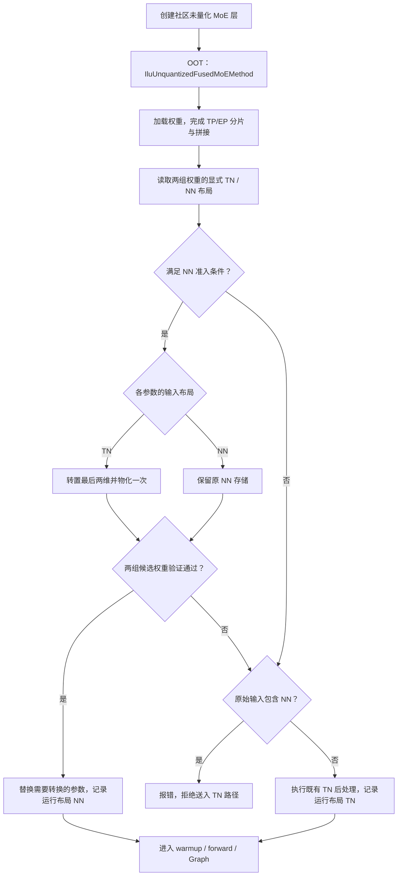
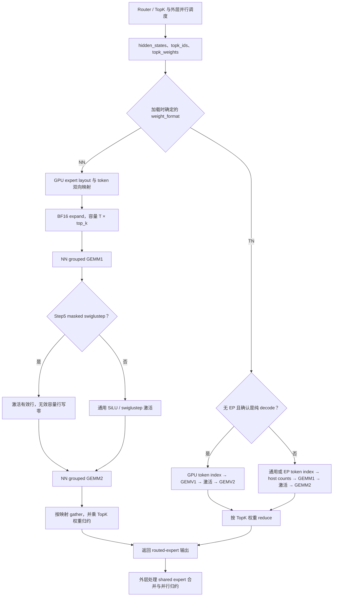

# BF16 MoE 设计

本文说明 vllm-iluvatar 如何通过 vLLM 的 OOT 扩展点接入未量化 MoE，包括权重布局选择、专家计算、路由精度与 CUDA Graph 执行边界。面向维护插件和接入模型的开发者。

## 1. 目标与范围

BF16 MoE 的插件实现负责把社区 vLLM 的未量化专家层接入 Iluvatar 后端：在加载阶段确定权重布局，在执行阶段组织路由映射、专家矩阵乘法、激活及加权归约。社区源码保持原样，替换入口使用官方 OOT 扩展点。

本文关注 W16A16 routed experts，说明 BF16 NN 与 TN 两条执行路径及其选择方式。Router 投影单列说明，因为 router 的 FP32 logits、权重精度与 expert 的 BF16 数据流承担不同职责。Shared expert 的执行与合并由外层 method/runner 和模型协调。

设计目标包括：

- 兼容显式 TN、NN 权重来源，在加载完成后固定运行布局。
- NN 路径使用设备端 expert layout 和 token 映射，减少对主机同步的依赖。
- 按平台能力和功能准入选择 NN 或 TN，并分别维护其执行契约。
- 保持 router 权重、激活、容量掩码和 TopK 权重的数值语义。
- 通过明确的准入和报错，避免将 NN 权重送入 TN 算子，或在 Graph 捕获时执行依赖 D2H 的路径。

本文聚焦未量化专家执行。量化方法和通信后端的内部协议由对应设计文档说明。

## 2. 模块职责

`IluUnquantizedFusedMoEMethod` 使用 `@UnquantizedFusedMoEMethod.register_oot()` 注册。插件初始化时发现并导入该模块，之后创建未量化 MoE method 时命中 OOT 实现。该类负责权重创建、加载后处理和 method/runner 接口适配。

`model_executor/layers/fused_moe/fused_moe.py` 提供共享入口 `ilu_w16a16_fused_experts`，按加载时确定的 `weight_format` 分派到内部 NN 或 TN 实现。布局转换不放在 forward 热路径中。

插件组织 token 映射、expand、grouped GEMM/GEMV、激活和 gather/reduce 等计算步骤，负责传递布局与 dtype，并在加载阶段检查所需计算能力是否可用。

Step5 在模型接线处选择 `Step5GateLinear`，并通过模型接线为专家层启用带容量掩码的激活分支。这些特化条件保持在模型接入与对应分支中。

## 3. 加载阶段：选择并固定运行布局

权重完成模型 loader 的分片、拼接后，`process_weights_after_loading()` 根据架构、功能配置和实际算子可用性判断能否采用 NN。内部标志用于记录执行状态，不能当作公开启动参数。



### 3.1 NN 准入条件

NN 路径要求目标平台支持相应执行能力，W13/W2 均为同设备 BF16，且 NN grouped GEMM 后端可用。激活支持 `silu` 和 `swiglustep`。

同时要求：未固定选择 TN、不是预处理权重模式、未启用 EPLB、专家层无 bias 和 LoRA、未要求在 expert 输入端乘 router 权重，且 all2all backend 不属于 `deepep_low_latency`、`deepep_high_throughput`、`deepep_v2`。

这里的专家 bias 与 router 的 score correction bias 是不同参数。满足 NN 准入后仍要验证权重形状、布局与对齐；平台具备 NN 能力只是准入条件之一。不满足 NN 条件时能否使用 TN，由 TN 的既有支持范围决定。

### 3.2 权重契约

设本 rank 专家数为 E、hidden size 为 H、分片后的 intermediate size 为 I：

- TN 来源：W13 为 `[E,2I,H]`，W2 为 `[E,H,I]`。
- NN 运行布局：W13 为 `[E,H,2I]`，W2 为 `[E,I,H]`。
- 两个参数的输入布局分别声明，允许来源布局不同；运行前统一为 NN。

NN 验证要求两个权重的专家数和 H/I 关系匹配，最后一维 stride 为 1，矩阵维度与 leading dimension 满足 32 对齐。原生 NN 来源保留其满足契约的存储，不能为了“统一加载”先转回 TN。

转换先构造并验证两组候选权重，全部通过后才替换参数。重复处理已归一化的 NN 权重时仅验证，不再次转置；已选定的 TN 在后续权重更新中保持 TN。

当前 NN 参数不接受通过 TN loader 进行热更新，该调用明确报错并要求重启模型。支持预处理 TN 权重不代表支持预处理 NN；两者需要分别检查。

## 4. 运行阶段：按固定布局执行

Router/TopK 及外层并行调度提供 hidden states、expert IDs 和权重。专家入口只处理这些张量及本 rank 的专家参数，不重新计算 router logits。



### 4.1 NN 数据流

输入为连续 CUDA BF16 `[T,H]`。路由 IDs 与权重具有相同 `[T,top_k]` 形状并处于同设备。入口将不符合契约的 IDs、权重分别规范为连续 int32、FP32；正常调用方应直接提供这两种格式，避免每次 forward 的转换与复制。

NN 路径采用固定容量 `capacity=T×top_k`，在设备端生成：

- `src_to_dst`：原始 token-route 到专家分组存储的映射。
- `dst_to_src`：专家分组存储到源路由的映射，同时标识有效容量行。
- `layout`：供 grouped GEMM 使用的专家分组描述。

`expert_map` 用于 global expert ID 到本 rank local expert ID 的映射。非本地路由由映射与 gather 契约处理；本地有多少有效行不需要回读 CPU 后再决定分配大小。

expand 形成 `[capacity,H]`，GEMM1 产生 gate/up `[capacity,2I]`，激活得到 `[capacity,I]`，GEMM2 产生专家输出，最终 gather/reduce 返回 `[T,H]`。两个 grouped GEMM 均使用 NN 权重和相同 layout。

T=0 直接返回空输出。无本地专家命中的情况需要通过映射得到零贡献；不能依赖未写缓冲恰好为零。

### 4.2 容量区与 Step5 SwiGLU

capacity 是分配上界，有效专家行数可以小于它。GEMM 只需计算 layout 指定的有效行，不承诺把所有未使用位置初始化。

Step5 的带容量掩码激活同时要求模型标志开启且激活为 `swiglustep`。该分支对映射无效的容量行直接写零，不读取该行 gate/up，因此未初始化值或 NaN 不会经该分支进入有效激活结果。有效行先提升为 FP32 进行激活计算，再写回 BF16。

对有效行，设 gate 为 g、up 为 u、limit 为正且 FP32 有限的 L，计算为：

```text
activated = BF16(min(SiLU(g), L) × clamp(u, -L, L))
```

gate 的 clamp 位于 SiLU 之后，且仅限制上界；L 使用层配置，默认值为 7.0。不能将它改写为先裁剪 gate 输入，或对 gate 做对称裁剪。

通用 SiLU/swiglustep 分支没有相同的 masked 激活保证。它们依赖 layout 和最终 gather 只消费有效数据；文档、测试和诊断工具都应区分“有效输出正确”与“所有容量区都已写零”。

### 4.3 TN 执行分流

TN 用于满足其执行条件的配置。纯 decode 且未进入 EP 分支时，GPU token index、两次 grouped GEMV 和 reduce 构成执行链。

普通 prefill、mixed 或 EP 路径使用 grouped GEMM，并将 expert counts 回读 CPU。TN 的 EP 实现保留按 EP rank 计算连续专家范围的既有逻辑；不能把 NN 对显式 `expert_map` 的能力直接视为 TN 具有相同映射能力。

NN 自身不按 pure decode/prefill 再分成两条 Python 执行链，也不因 batch 改变而重新转置权重。

## 5. CUDA Graph 与同步边界

NN 链路使用设备端 layout 和固定容量分配，避免依赖 expert counts 的 D2H。Graph replay 应允许在捕获所需的 shape、地址和执行结构保持兼容时改变设备端路由内容；这不等于支持任意 shape 或任意通信配置的整模 Graph。

TN 的纯 decode 判断来自 attention metadata 的普通整数计数，包括可识别的 speculative decode。多个 metadata 只要有一项报告 prefill，就不能判为纯 decode；没有可识别计数时也不判为纯 decode。

当前是否处于 Graph capture 不能作为“这是 decode”的依据。TN 通用/EP 路径会回读 CPU，捕获期间若没有命中安全 decode 路径，`_ensure_cuda_graph_safe_dispatch` 明确报错，提示使用对应安全图或 eager 执行。

外层 EP 通信、shared expert、输入准备和模型其他算子仍需各自满足捕获要求。Graph 可用性要以实际组合测试为准。

## 6. Router 精度与模型接入

Router 与 experts 的 dtype 分别管理。BF16 expert 参数不要求 router 参数也存为 BF16，router 输出精度由模型契约决定。

通用 `IluGateLinear` 通过 OOT 接入社区 GateLinear，保留其初始化状态和输出约定，在满足 dtype、形状及平台能力条件时选择优化投影。模型专用 router 在此基础上表达更具体的精度要求。

Step5 使用 `Step5GateLinear`，保留 FP32 gate 参数、FP32 logits 和 FP32 router bias。`prepare_native_weights()` 在加载阶段尝试生成 BF16 prepared weight，并验证转回 FP32 后与原权重逐值相等。只有通过无损检查的权重才进入 BF16 优化路径，原 FP32 参数继续保留。

小批量且满足输入、形状和平台条件时，Step5 选择 GEMV 投影；符合其他 prepared weight 条件时使用 GEMM 投影。无损检查未通过时，使用原 FP32 权重计算。权重准备发生在加载阶段，forward 不重复执行精度检查或布局转换。

Router 输出交给 TopK 后，专家入口消费选出的 IDs 和 FP32 路由权重。Router 优化不改变专家权重布局，也不将某个模型的权重降精度策略推广为通用 MoE 行为。

## 7. 支持边界与错误处理

- **NN 原始权重与不支持配置**：直接拒绝，不能将 NN 存储交给 TN 计算。
- **TN 原始权重与 NN 不可用**：保留既有 TN 后处理及其支持范围，不在 forward 中反复尝试转换。
- **NN 热更新**：通过 TN loader 更新已转换参数时拒绝，重启模型后重新加载。
- **Swiglustep limit**：取层配置并验证为正、FP32 有限值，enum 与字符串激活名称按统一方式解析。
- **容量与路由**：覆盖无本地专家、重复 routes、非连续 global/local 映射和未写尾部；NN 映射能力与 TN 既有 EP 范围分别测试。
- **权重和路由生命周期**：布局选择属于加载阶段，路由内容属于执行阶段；改变路由不应触发权重重排。

这些限制描述的是当前实现。后续扩展功能组合时，应同时修改准入条件、执行实现和测试，不能只放宽判断。

## 8. 设计验证

已有插件测试可作为设计回归入口：

- `tests/model_executor/layers/fused_moe/test_unquantized_fused_moe_method.py`：OOT、架构准入、权重转换一次性、NN 存储保留、TN 固定选择和预处理权重。
- `tests/model_executor/layers/fused_moe/test_fused_moe_nn.py`：NN 布局、EP 映射、数值和 Graph replay。
- `tests/model_executor/layers/fused_moe/test_fused_moe_tn.py`：既有 TN 分流、激活、数值、decode Graph 及普通 TN 捕获拒绝。
- `tests/model_executor/layers/fused_moe/test_fused_moe_hotpath.py`：正常输入下的额外操作、未写容量污染和路由格式兼容。
- `tests/model_executor/layers/fused_moe/test_ilu_gate_linear.py`：通用 router OOT 与 dtype/架构分发。

设计验证需要区分结构与分流测试、设备端数值测试以及模型组合测试。模型接入还应核对实际运行布局、expert ownership、router logits dtype，以及 shared expert 和并行归约的组合语义。

独立数值参考应保留各阶段 BF16 输出的舍入边界、TopK 权重和激活 limit。对 route IDs 还要核对专家选择语义；router 投影使用同一输入和权重的 FP32 计算作参考，避免混淆输出 dtype 与实际计算精度。

## 9. 代码导航

以下路径均相对 vllm-iluvatar 仓库根目录：

- `vllm_iluvatar/model_executor/layers/fused_moe/unquantized_fused_moe_method.py`：OOT method、权重创建与加载后处理。
- `vllm_iluvatar/model_executor/layers/fused_moe/fused_moe.py`：布局归一化、共享专家入口和 TN/NN 执行。
- `vllm_iluvatar/model_executor/layers/fused_moe/ilu_decode_metadata.py`：TN decode 分类和 Graph 安全检查。
- `vllm_iluvatar/model_executor/layers/fused_moe/router/ilu_gate_linear.py`：通用 GateLinear OOT。
- `vllm_iluvatar/models/step5/native_layers.py`：Step5 gate 权重准备与投影分流。
- `vllm_iluvatar/models/step5/model.py`：Step5 MoE 模型配置与特化接线。
- `tests/model_executor/layers/fused_moe/`：method、TN/NN 执行、router 和热路径相关测试。
